# SSLecture 後端資料庫設計文件

> **文件版本**：v1.16.1  
> **最後更新**：2026-11-25  
> **資料來源**：分析前端 `src/stores/auth.ts`、`src/stores/courses.ts`、`src/stores/bookings.ts`、localStorage 資料結構  
> **資料庫**：MySQL 8.4 LTS（8.0.16 以上皆可；第 6 節的 SQL 已實測可建立全部 22 張表，字元集、定序與連線時區的設定也見第 6 節）。
> 不適用 MariaDB 與 PostgreSQL（`CHECK`、運算式索引、`JSON` 的寫法不同）  
> **後端存取**：Spring Boot（見 [API 規格](./backend_api_spec.md)）以 Spring Data JPA（Hibernate）存取，
> 以 Liquibase 管理建表與日後的結構變更（後端 [`SSLecture_backend`](https://github.com/jaras0209/SSLecture_backend) 的
> `src/main/resources/db/changelog/`，內容與第 6、7 節相同）  
> **相關文件**：[文件導覽](./README.md)・[API 規格](./backend_api_spec.md)・[社群登入](./oauth2_social_login_spec.md)・各版本異動見文末[版本紀錄](#版本紀錄)

---

## 目錄

1. [資料庫設計總覽（ER Diagram）](#1-資料庫設計總覽)
2. [資料表詳細設計](#2-資料表詳細設計)
   - [users（使用者）](#21-users-使用者)
   - [churches（教會）](#22-churches-教會)
   - [courses（課程）](#23-courses-課程)
   - [lecturers（講師）](#24-lecturers-講師)
   - [lecturer_courses（講師授課關聯）](#25-lecturer_courses-講師授課關聯)
   - [listen_sessions（聽課紀錄）](#26-listen_sessions-聽課紀錄)
   - [student_assignments（學員關懷配對）](#27-student_assignments-學員關懷配對)
   - [shining_projects（閃耀計畫）](#28-shining_projects-閃耀計畫)
   - [shining_faith_checklists（信仰指標勾選）](#29-shining_faith_checklists-信仰指標勾選)
   - [shining_lectures（專題課登記）](#210-shining_lectures-專題課登記)
   - [themes（動態專題大綱）](#211-themes-動態專題大綱)
   - [page_restrictions（頁面存取限制）](#212-page_restrictions-頁面存取限制)
   - [refresh_tokens（Token 管理）](#213-refresh_tokens-jwt-token-管理)
   - [teaching_stats（年度教學統計）](#214-teaching_stats-年度教學統計)
   - [booking_sessions（預約場次）](#215-booking_sessions-預約場次)
   - [booking_attendees（場次學員）](#216-booking_attendees-場次學員)
   - [invite_codes（邀請碼）](#217-invite_codes-邀請碼)
   - [social_accounts（社群帳號綁定）](#218-social_accounts-社群帳號綁定)
   - [parent_children（家長綁定）](#219-parent_children-家長綁定)
   - [course_feedback（心得回覆）](#220-course_feedback-心得回覆)
   - [course_feedback_reads（回覆已讀）](#221-course_feedback_reads-回覆已讀)
   - [auth_attempts（嘗試次數）](#222-auth_attempts-嘗試次數)
3. [索引設計](#3-索引設計)
4. [資料關聯一覽](#4-資料關聯一覽)
5. [設計決策與說明](#5-設計決策與說明)
6. [SQL 建表語句（MySQL）](#6-sql-建表語句mysql)
7. [種子資料（Seed Data）](#7-種子資料seed-data)
8. [Mermaid ERD 關聯圖](#8-mermaid-erd-關聯圖)
9. [從前端備份搬移資料](#9-從前端備份搬移資料)

附錄：[版本紀錄](#版本紀錄)

---

## 1. 資料庫設計總覽

共 22 張表，依用途分組（`─<` 表示一對多，`>─<` 表示多對多；完整欄位與關聯見 [第 8 節 ERD](#8-mermaid-erd-關聯圖)，
外鍵清單見[第 4 節](#4-資料關聯一覽)）：

```
帳號與教會
  churches ─< users ─┬─< social_accounts      社群帳號綁定（Google / LINE）
                     ├─< refresh_tokens       JWT Refresh Token
                     └─< page_restrictions    頁面存取限制
  churches ─< invite_codes >─ users           邀請碼（建立者 / 使用者）
  auth_attempts                               登入等的失敗次數（無外鍵，見 2.22）

關懷
  users ─< student_assignments                學員 → 輔導教師、分區牧者
  users >─< users（parent_children）          家長 ↔ 孩子

課程、聽課與回覆
  courses >─< lecturers（lecturer_courses）   講師可授的課程；lecturers ─ users（連結帳號，可空）
  users ─< listen_sessions >─ courses         學員每次聽課一筆
  users ─< course_feedback >─ courses         教師、牧者對學員課程心得的回覆
  users ─< course_feedback_reads >─ courses   學員已讀到哪一則回覆（新回覆提醒）

預約
  users（教師）─< booking_sessions >─ courses, lecturers, churches
  booking_sessions ─< booking_attendees >─ users（學員）
  booking_attendees ─ listen_sessions         選填連結

閃耀計畫
  users ─ shining_projects ─┬─< shining_faith_checklists
                            └─< shining_lectures
  churches ─< themes                          各教會的專題大綱

統計
  users（教師）─< teaching_stats              年度教學人次
```

---

## 2. 資料表詳細設計

### 2.1 `users` 使用者

> **對應前端**：`auth.ts` → `usersDb`、`User` interface

| 欄位名 | 資料型別 | 限制 | 說明 |
|--------|----------|------|------|
| `id` | `CHAR(36)` | PK, NOT NULL | 系統唯一識別碼 |
| `username` | `VARCHAR(30)` | UNIQUE, NOT NULL, CHECK | 帳號：小寫、3–30 字元、只用英數字與 `. _ -`；系統內永不變的識別碼 |
| `password_hash` | `VARCHAR(255)` | NULL | bcrypt 雜湊密碼；NULL = 只用 Google / LINE 登入，不能以密碼登入 |
| `role` | `ENUM` | NOT NULL | `student` / `teacher` / `pastor` / `parent` / `admin` |
| `church_id` | `CHAR(36)` | FK → churches.id, NULL | 所屬教會（admin 為 NULL） |
| `display_name` | `VARCHAR(20)` | NULL | 暱稱（公開顯示）；從 Google / LINE 帶入的名稱超過 20 字時截斷 |
| `real_name` | `VARCHAR(50)` | NULL | 真實姓名（管理端顯示，不對學員公開） |
| `email` | `VARCHAR(255)` | NULL, UNIQUE（小寫） | 選填，可用來登入；孩子常沒有信箱所以可為空 |
| `email_verified` | `BOOLEAN` | NOT NULL, DEFAULT FALSE | 信箱是否已驗證；社群帳號自動合併的前提 |
| `must_change_password` | `BOOLEAN` | NOT NULL, DEFAULT FALSE | 管理員建立帳號或重設密碼後為 TRUE，使用者改密碼後清除 |
| `gender` | `ENUM` | NULL | `male` / `female`；只用於 `student`、`teacher`，由牧者或管理員設定 |
| `avatar_url` | `VARCHAR(2048)` | NULL, CHECK `https://` | 頭像圖片 URL；只接受 `https://`（前端 `isAllowedAvatarUrl()`） |
| `login_method` | `ENUM` | NOT NULL, DEFAULT 'credentials' | `credentials` / `google` / `line` |
| `token_version` | `INTEGER` | NOT NULL, DEFAULT 0 | 停用、改角色、重設或修改密碼時遞增；版本不符的 Token 失效（見 5.15） |
| `is_active` | `BOOLEAN` | NOT NULL, DEFAULT TRUE | 帳號是否啟用（FALSE = 軟刪除） |
| `last_login_at` | `DATETIME(3)` | NULL | 最後登入時間 |
| `created_at` | `DATETIME(3)` | NOT NULL, DEFAULT CURRENT_TIMESTAMP(3) | 建立時間 |
| `updated_at` | `DATETIME(3)` | NOT NULL, DEFAULT CURRENT_TIMESTAMP(3) | 最後更新時間 |

**設計說明**：
- `username` 唯一索引，用於登入
- `role` 決定整個系統的存取權限邏輯
- `admin` 角色的 `church_id` 為 NULL（跨教會管理）
- `real_name` 僅用於管理端（教師/牧者/管理員）顯示，不對學員公開
- `is_active = FALSE` 為軟刪除，歷史資料保留；軟刪除時須一併做 [5.12](#512-刪除帳號或變更角色時的清理) 的清理
- 軟刪除的帳號列仍在，`username` 的唯一限制照常生效：歷史資料掛在這個名稱下，同名的新帳號會看到前一位的資料，所以名稱不可重新使用
- `token_version`：停用、改角色、重設或修改密碼時遞增，讓既有的登入立即失效（見 [5.15](#515-登入期限與失效)）
- `avatar_url` 只接受 `https://`：頭像會在每位看到的人的瀏覽器載入，`http://` 或其他網址可被用來追蹤誰在何時看了名冊；
  前端也會在載入時不帶來源頁面（`referrerpolicy="no-referrer"`），失效時改顯示預設頭像
- 社群登入（Google / LINE）的使用者同樣是 `users` 的一筆資料，`password_hash` 為 NULL；
  完成 onboarding（填入教會）後，牧者與管理員才能在名冊看到並設定性別、指派教師、綁定家長
- `gender` 只對 `student`、`teacher` 有意義（前端 `GENDERED_ROLES`）；NULL 表示尚未設定，
  此時教師看不到該學員、未設定性別的教師看不到任何學員（見 5.10）

---

### 2.2 `churches` 教會

> **對應前端**：`auth.ts` → `CHURCHES` 常數陣列（19 間教會）

| 欄位名 | 資料型別 | 限制 | 說明 |
|--------|----------|------|------|
| `id` | `CHAR(36)` | PK, NOT NULL | 唯一識別碼 |
| `name` | `VARCHAR(100)` | UNIQUE, NOT NULL | 教會名稱（如「愛與話語」） |
| `region` | `VARCHAR(100)` | NULL | 地區（如「台北」） |
| `is_active` | `BOOLEAN` | NOT NULL, DEFAULT TRUE | 是否啟用 |
| `created_at` | `DATETIME(3)` | NOT NULL, DEFAULT CURRENT_TIMESTAMP(3) | 建立時間 |

**內建資料（19 間）**：
`愛與話語`、`主大明`、`主勝利`、`主生命`、`主和睦光`、`台北主話語`、`聖靈`、`永明`、`主希望光`、`實踐`、`主愛`、`主大永`、`主磐石`、`信主`、`宜蘭主話語`、`天民`、`主幸福`、`信榮`、`主盼望`

---

### 2.3 `courses` 課程

> **對應前端**：`courses.ts` → `Course` interface、`rawCoursesList` 固定清單

| 欄位名 | 資料型別 | 限制 | 說明 |
|--------|----------|------|------|
| `id` | `VARCHAR(20)` | PK, NOT NULL | 格式：`bible-01`、`lecture-01` |
| `title` | `VARCHAR(100)` | NOT NULL | 課程名稱 |
| `category` | `ENUM` | NOT NULL | `bible`（聖經課程）/ `lecture`（專題講座） |
| `description` | `TEXT` | NULL | 課程說明 |
| `cover_color` | `VARCHAR(200)` | NULL | CSS 顏色或漸層字串 |
| `duration_seconds` | `INTEGER` | NOT NULL, DEFAULT 0 | 課程時長（秒） |
| `sort_order` | `INTEGER` | NOT NULL, DEFAULT 0 | 顯示排序 |
| `is_active` | `BOOLEAN` | NOT NULL, DEFAULT TRUE | 是否啟用 |
| `created_at` | `DATETIME(3)` | NOT NULL, DEFAULT CURRENT_TIMESTAMP(3) | 建立時間 |

**內建 30 堂課**：
- 聖經課程 15 堂（`bible-01` ～ `bible-15`）
- 專題講座 15 堂（`lecture-01` ～ `lecture-15`）

---

### 2.4 `lecturers` 講師

> **對應前端**：`courses.ts` → `Lecturer` interface、`lecturers` store

| 欄位名 | 資料型別 | 限制 | 說明 |
|--------|----------|------|------|
| `id` | `CHAR(36)` | PK, NOT NULL | 唯一識別碼 |
| `name` | `VARCHAR(50)` | NOT NULL | 講師顯示名稱 |
| `title` | `VARCHAR(30)` | NOT NULL | 稱謂代碼：`lecturer`、`pastor`、`preacher`、`elder`、`pastor_wife`、`counselor`、`guest`；畫面依語言翻譯（見設計說明） |
| `church_id` | `CHAR(36)` | FK → churches.id, NULL | 所屬教會（NULL 表示跨教會） |
| `linked_user_id` | `CHAR(36)` | FK → users.id, NULL | 連結的教師或牧者帳號（NULL = 外來/自訂講師） |
| `is_active` | `BOOLEAN` | NOT NULL, DEFAULT TRUE | 是否啟用 |
| `created_at` | `DATETIME(3)` | NOT NULL, DEFAULT CURRENT_TIMESTAMP(3) | 建立時間 |
| `updated_at` | `DATETIME(3)` | NOT NULL, DEFAULT CURRENT_TIMESTAMP(3) | 最後更新時間 |

**設計說明**：
- `linked_user_id` 是選填欄位：
  - 有值 → 講師為系統內的教師或牧者帳號（`role IN ('teacher','pastor')`，應用端檢查），可自動同步姓名與統計，
    該帳號有「我的授課」（見 5.11）
  - NULL → 自訂講師或外來講員，僅儲存名稱字串
- 同一位教師帳號在同一教會應僅連結一筆講師記錄（建議應用端進行檢查）
- `title` 存代碼而非中文字，英文介面才能顯示 "Pastor" 而非「牧師」；翻譯在前端
  （`teacher.lecturer.titleOptions.{code}`）。不設 CHECK 限制：早期資料存的是中文字，
  前端讀取時會換成代碼（`src/utils/lecturerTitle.ts`），認不得的稱謂原樣保留並原樣顯示。
  匯入舊資料時請依同一份對照表轉換（牧師→`pastor`、傳道／傳道人→`preacher`、長老→`elder`、
  師母→`pastor_wife`、輔導→`counselor`、講師→`lecturer`、特約講師→`guest`）

**唯一性**：同一教會不重複列同名、同稱謂的講師（`uq_lecturers_church_name`）；一個帳號只連結一筆講師資料（`uq_lecturers_linked_user`）。都只計啟用中（`is_active`）的講師；`church_id` 為 NULL 的講師不受前者限制。

---

### 2.5 `lecturer_courses` 講師授課關聯

> **對應前端**：`Lecturer.courseIds[]` — 一位講師可授多門課程（多對多）

| 欄位名 | 資料型別 | 限制 | 說明 |
|--------|----------|------|------|
| `lecturer_id` | `CHAR(36)` | FK → lecturers.id, NOT NULL | 講師 |
| `course_id` | `VARCHAR(20)` | FK → courses.id, NOT NULL | 課程 |

**複合主鍵**：`(lecturer_id, course_id)`

---

### 2.6 `listen_sessions` 聽課紀錄

> **對應前端**：`courses.ts` → `ListenSession` interface、`ProgressRecord.sessions[]`  
> **核心設計**：每次聽課新增一筆，不覆蓋；同一課程可有多筆（複習）

| 欄位名 | 資料型別 | 限制 | 說明 |
|--------|----------|------|------|
| `id` | `CHAR(36)` | PK, NOT NULL | 唯一識別碼 |
| `student_id` | `CHAR(36)` | FK → users.id, NOT NULL, ON DELETE RESTRICT | 學員；帳號軟刪除，聽課紀錄保留 |
| `course_id` | `VARCHAR(20)` | FK → courses.id, NOT NULL | 課程 |
| `lecturer_name` | `VARCHAR(50)` | NOT NULL | 授課講師名稱（自由文字，來自 lecturers.name + title） |
| `listened_at` | `DATETIME(3)` | NOT NULL, CHECK | 學員填報的聽課時間；不可晚於寫入時間 1 小時以上（見 5.17） |
| `notes` | `VARCHAR(2000)` | NULL | 學員心得（可為空） |
| `created_at` | `DATETIME(3)` | NOT NULL, DEFAULT CURRENT_TIMESTAMP(3) | 系統建立時間（不可修改） |
| `updated_at` | `DATETIME(3)` | NULL | 最後修改時間（NULL 表示從未修改） |

**業務邏輯**：
- 同一 `(student_id, course_id)` 可有多筆，不做 UNIQUE 限制
- 只要此學員此課程有任何一筆記錄，即視為「已完成」
- `lecturer_name` 儲存為自由文字（講師名+職稱），不做外鍵關聯，允許歷史紀錄保留即使講師被刪除

> **為何不用外鍵關聯 lecturer？**  
> 學員選擇的講師在填報當下已固定，若未來講師資料被修改或刪除，不應影響歷史紀錄。

---

### 2.7 `student_assignments` 學員關懷配對

> **對應前端**：`courses.ts` → `StudentCaretakers` interface、`studentTeacherDb`  
> 每位學員最多配對兩種角色：teacher / pastor（家長綁定改記錄於 [`parent_children`](#219-parent_children-家長綁定)）

| 欄位名 | 資料型別 | 限制 | 說明 |
|--------|----------|------|------|
| `id` | `CHAR(36)` | PK, NOT NULL | 唯一識別碼 |
| `student_id` | `CHAR(36)` | UNIQUE, FK → users.id, NOT NULL | 學員（唯一，一位學員只有一筆配對記錄） |
| `teacher_id` | `CHAR(36)` | FK → users.id, NULL | 輔導教師（可為空） |
| `pastor_id` | `CHAR(36)` | FK → users.id, NULL | 分區牧者（可為空） |
| `updated_at` | `DATETIME(3)` | NOT NULL, DEFAULT CURRENT_TIMESTAMP(3) | 最後更新時間 |

**設計說明**：
- `student_id` 加 UNIQUE，確保一位學員只有一筆配對記錄（UPSERT 操作）
- `teacher_id`、`pastor_id` 皆可獨立為 NULL（未配對）
- 刪除配對時將對應欄位設為 NULL 即可
- `teacher_id` 只能指向看得到這位學員的教師：同教會、同性別、雙方皆已設定性別
  （前端 `canMentor()`；後端寫入時須檢查）

---

### 2.8 `shining_projects` 閃耀計畫

> **對應前端**：`courses.ts` → `ShiningProject` interface 的基本資料部分

| 欄位名 | 資料型別 | 限制 | 說明 |
|--------|----------|------|------|
| `id` | `CHAR(36)` | PK, NOT NULL | 唯一識別碼 |
| `student_id` | `CHAR(36)` | UNIQUE, FK → users.id, NOT NULL | 學員（一人一筆） |
| `name` | `VARCHAR(50)` | NULL | 真實姓名 |
| `birthday` | `DATE` | NULL, CHECK | 生日；介於 1900-01-01 與今天之間（見 5.17） |
| `church_name` | `VARCHAR(100)` | NULL | 聚會教會（學員填報，可與 users.church_id 不同） |
| `school_grade` | `VARCHAR(50)` | NULL | 學校年級（如「師大附中 高一」） |
| `custom_challenge` | `VARCHAR(200)` | NULL | 自訂進階挑戰文字 |
| `created_at` | `DATETIME(3)` | NOT NULL, DEFAULT CURRENT_TIMESTAMP(3) | 建立時間 |
| `updated_at` | `DATETIME(3)` | NOT NULL, DEFAULT CURRENT_TIMESTAMP(3) | 最後更新時間 |

---

### 2.9 `shining_faith_checklists` 信仰指標勾選

> **對應前端**：`ShiningProject.faithPhase1`、`faithPhase2`、`advancedChallenges`  
> 共 3 個類別 × 5 個項目 = 最多 15 筆（每個 checkbox 一筆）

| 欄位名 | 資料型別 | 限制 | 說明 |
|--------|----------|------|------|
| `id` | `CHAR(36)` | PK, NOT NULL | 唯一識別碼 |
| `shining_project_id` | `CHAR(36)` | FK → shining_projects.id, NOT NULL | 所屬閃耀計畫 |
| `category` | `ENUM` | NOT NULL | `faith_phase1` / `faith_phase2` / `advanced_challenges` |
| `item_key` | `VARCHAR(50)` | NOT NULL | 項目 key（如 `worship`、`prayer`、`courses30`） |
| `is_checked` | `BOOLEAN` | NOT NULL, DEFAULT FALSE | 是否勾選 |
| `updated_at` | `DATETIME(3)` | NOT NULL, DEFAULT CURRENT_TIMESTAMP(3) | 最後更新時間 |

**複合唯一鍵**：`(shining_project_id, category, item_key)`

**所有 item_key 清單**：

| category | item_key | 說明 |
|----------|----------|------|
| `faith_phase1` | `worship` | 每週持守主日禮拜 |
| `faith_phase1` | `prayer` | 每天禱告 10-15 分鐘 |
| `faith_phase1` | `independent` | 自主參與信仰 |
| `faith_phase1` | `reply` | 主動聯絡教師回覆訊息 |
| `faith_phase1` | `share` | 願意分享體會經歷 |
| `faith_phase2` | `courses30` | 聽完 30 個論（系統自動判斷） |
| `faith_phase2` | `prayer_long` | 每天禱告 20-30 分鐘 |
| `faith_phase2` | `morning_worship` | 晨禱 |
| `faith_phase2` | `read_bible` | 讀聖經 |
| `faith_phase2` | `church_service` | 教會服事 |
| `advanced_challenges` | `wednesday` | 週三聚會 |
| `advanced_challenges` | `share_faith` | 傳福音/分享信仰 |
| `advanced_challenges` | `copy_sermon` | 謄寫講道 |
| `advanced_challenges` | `morning_proverb` | 晨間箴言 |
| `advanced_challenges` | `custom` | 自訂挑戰（配合 custom_challenge 欄位） |

---

### 2.10 `shining_lectures` 專題課登記

> **對應前端**：`ShiningProject.characterLectures`、`ShiningProject.comingOfAgeTopics`  
> 學員每個專題主題只有一筆紀錄（講師 + 日期）

| 欄位名 | 資料型別 | 限制 | 說明 |
|--------|----------|------|------|
| `id` | `CHAR(36)` | PK, NOT NULL | 唯一識別碼 |
| `shining_project_id` | `CHAR(36)` | FK → shining_projects.id, NOT NULL | 所屬閃耀計畫 |
| `type` | `ENUM` | NOT NULL | `character`（品格力）/ `coming_of_age`（成年禮必修） |
| `theme_name` | `VARCHAR(50)` | NOT NULL | 主題名稱（來自 themes 表，但儲存文字以保留歷史） |
| `speaker_name` | `VARCHAR(50)` | NULL | 授課講師名稱（自由文字） |
| `lecture_date` | `DATE` | NULL | 上課日期；不可晚於今天（API 檢查，見 5.17） |
| `created_at` | `DATETIME(3)` | NOT NULL, DEFAULT CURRENT_TIMESTAMP(3) | 建立時間 |
| `updated_at` | `DATETIME(3)` | NOT NULL, DEFAULT CURRENT_TIMESTAMP(3) | 最後更新時間 |

**複合唯一鍵**：`(shining_project_id, type, theme_name)`

---

### 2.11 `themes` 動態專題大綱

> **對應前端**：`courses.ts` → `characterThemesDb`、`comingOfAgeThemesDb`  
> 由各教會的教師/牧者動態管理，各教會獨立維護

| 欄位名 | 資料型別 | 限制 | 說明 |
|--------|----------|------|------|
| `id` | `CHAR(36)` | PK, NOT NULL | 唯一識別碼 |
| `church_id` | `CHAR(36)` | FK → churches.id, NOT NULL | 所屬教會 |
| `type` | `ENUM` | NOT NULL | `character`（品格力）/ `coming_of_age`（成年禮） |
| `name` | `VARCHAR(50)` | NOT NULL | 主題名稱（如「品格力 - 自律」） |
| `sort_order` | `INTEGER` | NOT NULL, DEFAULT 0 | 顯示排序 |
| `is_active` | `BOOLEAN` | NOT NULL, DEFAULT TRUE | 是否啟用 |
| `created_at` | `DATETIME(3)` | NOT NULL, DEFAULT CURRENT_TIMESTAMP(3) | 建立時間 |

**複合唯一鍵**：`(church_id, type, name)`

**內建種子資料**：
- `character`（品格力）：`品格力 - 自律`、`品格力 - 感謝`、`品格力 - 勇氣`、`品格力 - 正直`
- `coming_of_age`（成年禮）：`基督教歷史`、`台灣攝理歷史`、`情感教育`、`R的使命與精神`

---

### 2.12 `page_restrictions` 頁面存取限制

> **對應前端**：`courses.ts` → `PageRestrictionsDb`、`restrictionsDb`  
> 由管理員對特定帳號限制特定頁面的存取

| 欄位名 | 資料型別 | 限制 | 說明 |
|--------|----------|------|------|
| `id` | `CHAR(36)` | PK, NOT NULL | 唯一識別碼 |
| `user_id` | `CHAR(36)` | FK → users.id, NOT NULL | 被限制的使用者 |
| `page_path` | `VARCHAR(100)` | NOT NULL | 被限制的頁面路徑（如 `/shining`） |
| `created_at` | `DATETIME(3)` | NOT NULL, DEFAULT CURRENT_TIMESTAMP(3) | 建立時間 |

**複合唯一鍵**：`(user_id, page_path)`

---

### 2.13 `refresh_tokens` JWT Token 管理

> **對應前端**：未來串接 JWT 認證時所需的 Refresh Token 儲存表

| 欄位名 | 資料型別 | 限制 | 說明 |
|--------|----------|------|------|
| `id` | `CHAR(36)` | PK, NOT NULL | 唯一識別碼 |
| `user_id` | `CHAR(36)` | FK → users.id, NOT NULL | 所屬使用者 |
| `token_hash` | `VARCHAR(255)` | UNIQUE, NOT NULL | Refresh Token 的 SHA256 雜湊值 |
| `remember_me` | `BOOLEAN` | NOT NULL, DEFAULT FALSE | 登入時是否勾選「記住我」（社群登入一律 FALSE） |
| `token_version` | `INTEGER` | NOT NULL | 簽發時的 `users.token_version`；不符即失效 |
| `expires_at` | `DATETIME(3)` | NOT NULL | 失效時間；每次換發時順延（見設計說明） |
| `is_revoked` | `BOOLEAN` | NOT NULL, DEFAULT FALSE | 是否已被撤銷（見設計說明） |
| `created_at` | `DATETIME(3)` | NOT NULL, DEFAULT CURRENT_TIMESTAMP(3) | 建立時間 |
| `last_used_at` | `DATETIME(3)` | NULL | 最後使用時間 |

**設計說明**：
- 期限是**閒置**期限，每次換發時順延：`remember_me = FALSE` 為 `last_used_at + 2 小時`，`TRUE` 為 `+ 30 天`
  （與前端 `src/utils/session.ts` 一致）。前端在閒置到期與瀏覽器重新開啟時也會自行登出，但期限以這裡為準
- 撤銷時機：登出（只撤銷這一個）；帳號停用、改角色、管理員重設密碼（撤銷該帳號全部）；
  使用者自己改密碼（撤銷該帳號其他的，保留目前這個）。也可以不逐筆撤銷，改為遞增 `users.token_version`
- 換發時重新讀取帳號：`users.is_active = FALSE` 或 `token_version` 不符就拒絕

---

### 2.14 `teaching_stats` 年度教學統計

> **對應前端**：`courses.ts` → `TeachingStats` interface，`superstart_teaching_stats_db` localStorage key

| 欄位名 | 資料型別 | 限制 | 說明 |
|--------|----------|------|------|
| `id` | `CHAR(36)` | PK, NOT NULL | 系統唯一識別碼 |
| `teacher_id` | `CHAR(36)` | FK → users.id, NOT NULL, ON DELETE RESTRICT | 教師帳號（role = teacher）；帳號軟刪除，統計保留為歷史 |
| `year` | `SMALLINT` | NOT NULL, CHECK >= 2020 | 統計年度（如 2025） |
| `one_on_one_30` | `INTEGER` | NOT NULL, DEFAULT 0, CHECK >= 0 | 1對1 講「三十個論」人次 |
| `one_to_many_30` | `INTEGER` | NOT NULL, DEFAULT 0, CHECK >= 0 | 1對多 講「三十個論」人次 |
| `one_on_one_shining` | `INTEGER` | NOT NULL, DEFAULT 0, CHECK >= 0 | 1對1 講「閃耀計畫課程」人次 |
| `one_to_many_shining` | `INTEGER` | NOT NULL, DEFAULT 0, CHECK >= 0 | 1對多 講「閃耀計畫課程」人次 |
| `submitted_at` | `DATETIME(3)` | NULL | 最後申報/更新時間 |
| `created_at` | `DATETIME(3)` | NOT NULL, DEFAULT CURRENT_TIMESTAMP(3) | 建立時間 |
| `updated_at` | `DATETIME(3)` | NOT NULL, DEFAULT CURRENT_TIMESTAMP(3) | 最後更新時間 |

**設計說明**：
- `(teacher_id, year)` 為複合唯一鍵，保證每位教師每年度僅一筆紀錄
- 人次對應前端計算規則：一次對多人講義以「人次」計（如一次對3人 = 3人次）
- 後端可用 `GROUP BY year` 提供跨教會的年度比較

**SQL DDL**：見[第 6 節](#6-sql-建表語句mysql)（依相依順序與其他表一起建立）。

---

### 2.15 `booking_sessions` 預約場次

> **對應前端**：`bookings.ts` → `BookingSession` interface，`superstart_booking_sessions_db` localStorage key  
> **新增於**：v1.3.0（2026-06-30）

| 欄位名 | 資料型別 | 限制 | 說明 |
|--------|----------|------|------|
| `id` | `CHAR(36)` | PK, NOT NULL | 系統產生；前端 mock 的 `sess_...` 只是暫時格式，API 一律當不透明字串處理 |
| `teacher_id` | `CHAR(36)` | FK → users.id, NOT NULL, ON DELETE RESTRICT | 建立並管理預約的輔導教師 |
| `church_id` | `CHAR(36)` | FK → churches.id, NULL | 場次所屬教會 |
| `course_id` | `VARCHAR(20)` | FK → courses.id, NULL | 對應課程（與 courses.id 同型別） |
| `course_title` | `VARCHAR(200)` | NOT NULL | 課程名稱（冗餘儲存，保留歷史） |
| `lecturer_id` | `CHAR(36)` | FK → lecturers.id, NULL | 對應講師（連結帳號的講師可在「我的授課」看到此預約，見 5.11） |
| `lecturer_name` | `VARCHAR(50)` | NOT NULL | 講師姓名（冗餘儲存） |
| `lecturer_title` | `VARCHAR(30)` | NOT NULL, DEFAULT '' | 講師稱謂代碼（如 `pastor`，同 `lecturers.title`） |
| `proposed_at` | `DATETIME(3)` | NOT NULL | 教師提議的時間 |
| `confirmed_at` | `DATETIME(3)` | NULL | 最終確認的時間（雙方同意後填入） |
| `duration_minutes` | `SMALLINT` | NULL, CHECK >= 1 | 預計課程時長（分鐘） |
| `status` | `VARCHAR(20)` | NOT NULL, DEFAULT 'pending' | `pending / confirmed / completed / cancelled` |
| `cancel_reason` | `VARCHAR(500)` | NULL | 取消原因（status = cancelled 時填入） |
| `teacher_session_notes` | `VARCHAR(2000)` | NULL | 教師整場備注（完成後填寫） |
| `is_group_session` | `BOOLEAN` | NOT NULL, DEFAULT FALSE | 是否為團體聽課 |
| `prep_scriptures` | `JSON` | NOT NULL, DEFAULT (JSON_ARRAY()), CHECK | 預習經文列表：字串陣列，每段最多 100 字（`JSON_SCHEMA_VALID` 檢查） |
| `prep_reading_notes` | `VARCHAR(2000)` | NULL | 預習說明 |
| `prep_materials` | `VARCHAR(500)` | NULL | 補充材料說明 |
| `created_at` | `DATETIME(3)` | NOT NULL, DEFAULT CURRENT_TIMESTAMP(3) | 建立時間 |
| `updated_at` | `DATETIME(3)` | NOT NULL, DEFAULT CURRENT_TIMESTAMP(3) | 最後更新時間 |

**狀態機**：
```
pending ──confirm──> confirmed ──complete──> completed
  │                      │
  └──cancel──────────────┴──cancel──> cancelled
```

**設計說明**：
- `course_title`、`lecturer_name`、`lecturer_title` 冗餘儲存，避免講師/課程被刪除後歷史資料遺失
- `prep_scriptures` 存成 JSON 字串陣列（如 `["約翰福音 3:16"]`），JPA 以 `@JdbcTypeCode(SqlTypes.JSON)` 對應 `List<String>`
- 建議後端在 `status = completed` 時自動 trigger 同步至 `listen_sessions`（若需要）
- 誰能看、誰能改：安排的教師管理整筆預約，但只看得到同性別的學員；連結帳號的講師看得到全部學員
  並可記錄出席（見 5.10、5.11）
- 刪除教師帳號或變更其角色時，`pending` / `confirmed` 的預約改為 `cancelled` 並附原因（見 5.12）

**SQL DDL**：見[第 6 節](#6-sql-建表語句mysql)（依相依順序與其他表一起建立）。

---

### 2.16 `booking_attendees` 場次學員

> **對應前端**：`bookings.ts` → `BookingAttendee` interface，`superstart_booking_attendees_db` localStorage key  
> **新增於**：v1.3.0（2026-06-30）

| 欄位名 | 資料型別 | 限制 | 說明 |
|--------|----------|------|------|
| `session_id` | `CHAR(36)` | PK, FK → booking_sessions.id, NOT NULL | 所屬預約場次 |
| `student_id` | `CHAR(36)` | PK, FK → users.id, NOT NULL, ON DELETE RESTRICT | 受邀學員；帳號軟刪除，出席紀錄保留 |
| `attendance_status` | `VARCHAR(20)` | NOT NULL, DEFAULT 'invited' | `invited / attended / absent` |
| `student_feedback` | `VARCHAR(1000)` | NULL | 學員課後心得（由學員自行填寫） |
| `teacher_feedback` | `VARCHAR(1000)` | NULL | 教師對該學員的個別回饋 |
| `feedback_at` | `DATETIME(3)` | NULL | 回饋最後更新時間 |
| `linked_listen_session_id` | `CHAR(36)` | FK → listen_sessions.id, NULL | 手動連結至聽課進度紀錄 |
| `created_at` | `DATETIME(3)` | NOT NULL, DEFAULT CURRENT_TIMESTAMP(3) | 建立時間 |
| `updated_at` | `DATETIME(3)` | NOT NULL, DEFAULT CURRENT_TIMESTAMP(3) | 最後更新時間 |

**設計說明**：
- 主鍵為 `(session_id, student_id)`：同一場次同一學員只有一筆，不需要另外的 `id`
  （API 也以「場次 + 學員帳號」定位，例如 `PATCH /bookings/sessions/:id/attendees/:username`）
- `attendance_status` 由教師在場次完成後填寫，預設 `invited`
- `student_feedback` 由學員自行從學員端填寫
- `linked_listen_session_id` 為選填，允許手動關聯到已存在的 `listen_sessions` 紀錄
- 不另存學員帳號：帳號是永不變的識別碼，需要時由 `student_id` JOIN `users` 取得（見 5.7）

**SQL DDL**：見[第 6 節](#6-sql-建表語句mysql)（依相依順序與其他表一起建立）。

---

### 2.17 `invite_codes` 邀請碼

> **對應前端**：`auth.ts` → `InviteCode` interface，`superstart_invite_codes` localStorage key  
> **新增於**：v1.4.0（2026-07-30）

| 欄位名 | 資料型別 | 限制 | 說明 |
|--------|----------|------|------|
| `code` | `VARCHAR(20)` | PK, NOT NULL | 邀請碼（例：`SS-TCH-K7M2QX9D`） |
| `role` | `ENUM` | NOT NULL | 允許註冊的角色 |
| `church_id` | `CHAR(36)` | FK → churches.id, NULL | 指定教會（admin為NULL） |
| `created_by` | `CHAR(36)` | FK → users.id, NULL, ON DELETE SET NULL | 產生此邀請碼的管理員 ID（管理員被刪除後置 NULL） |
| `created_at` | `DATETIME(3)` | NOT NULL, DEFAULT CURRENT_TIMESTAMP(3) | 建立時間 |
| `expires_at` | `DATETIME(3)` | NOT NULL | 到期時間 |
| `used_by` | `CHAR(36)` | FK → users.id, NULL | 使用此邀請碼註冊的帳號 ID |
| `used_at` | `DATETIME(3)` | NULL | 使用時間 |
| `revoked` | `BOOLEAN` | NOT NULL, DEFAULT FALSE | 是否已被管理員作廢 |

**設計說明**：
- `code` 為主鍵，具唯一性
- 透過 `role` 和 `church_id` 來鎖定使用者註冊時可獲得的權限
- 外鍵均使用 `ON DELETE SET NULL`，避免教會或管理員被刪除時連帶刪除邀請碼歷史（詳見 Section 5.8）
- 有效判斷：`revoked = FALSE AND used_by IS NULL AND expires_at > NOW()`

**SQL DDL**：見[第 6 節](#6-sql-建表語句mysql)（依相依順序與其他表一起建立）。

---

### 2.18 `social_accounts` 社群帳號綁定

> **新增於**：v1.6.0（2026-08-14）  
> **用途**：儲存使用者透過 Google / LINE OAuth2 登入後的第三方帳號綁定資料。一個使用者可以綁定多個社群平台帳號。

| 欄位名 | 資料型別 | 限制 | 說明 |
|--------|----------|------|------|
| `id` | `CHAR(36)` | PK, DEFAULT (UUID()) | 主鍵 |
| `user_id` | `CHAR(36)` | FK → users.id, NOT NULL, ON DELETE CASCADE | 對應的使用者 |
| `provider` | `VARCHAR(20)` | NOT NULL | 第三方平台（`google` / `line`） |
| `provider_user_id` | `VARCHAR(255)` | NOT NULL | 第三方平台的使用者唯一 ID |
| `email` | `VARCHAR(255)` | NULL | 從第三方取得的 email（LINE 不一定有） |
| `display_name` | `VARCHAR(255)` | NULL | 第三方顯示名稱 |
| `avatar_url` | `TEXT` | NULL | 第三方頭像 URL |
| `access_token` | `TEXT` | NULL | 第三方 Access Token（加密儲存） |
| `refresh_token` | `TEXT` | NULL | 第三方 Refresh Token（加密儲存，若有） |
| `token_expires_at` | `DATETIME(3)` | NULL | Access Token 到期時間 |
| `created_at` | `DATETIME(3)` | NOT NULL, DEFAULT CURRENT_TIMESTAMP(3) | 首次綁定時間 |
| `updated_at` | `DATETIME(3)` | NOT NULL, DEFAULT CURRENT_TIMESTAMP(3) | 最近更新時間（Token 更新時） |

**Unique 約束**：
- `UNIQUE (provider, provider_user_id)`：同一平台的使用者 ID 全域唯一（防止同帳號綁定多個本地使用者）
- `UNIQUE (user_id, provider)`：一個使用者在同平台只能綁定一次

**設計說明**：
- `ON DELETE CASCADE`：本地使用者帳號被刪除時，自動刪除所有關聯的社群綁定記錄
- `provider_user_id` 是從 OAuth2 Provider 取得的 `sub`（Google）或 `userId`（LINE）
- 相同 email 的不同 provider 可自動合併到同一 `user_id`（由後端 `SocialAccountService` 處理）
- `access_token` / `refresh_token` 建議使用 AES-256 加密後儲存，在 `application.yml` 設定密鑰

**SQL DDL**：見[第 6 節](#6-sql-建表語句mysql)（依相依順序與其他表一起建立）。

---

### 2.19 `parent_children` 家長綁定

> **對應前端**：`auth.ts` → 家長帳號的 `childUsernames`（`bindChild()` / `unbindChild()` / `parentsOf()` / `childrenOf()`）  
> **新增於**：v1.7.0（2026-10-30），取代 `student_assignments.parent_id`

| 欄位名 | 資料型別 | 限制 | 說明 |
|--------|----------|------|------|
| `parent_id` | `CHAR(36)` | PK, FK → users.id, NOT NULL | 家長帳號（`role = 'parent'`） |
| `student_id` | `CHAR(36)` | PK, FK → users.id, NOT NULL | 綁定的孩子（`role = 'student'`） |
| `bound_at` | `DATETIME(3)` | NOT NULL, DEFAULT CURRENT_TIMESTAMP(3) | 綁定時間 |

**複合主鍵**：`(parent_id, student_id)`

**設計說明**：
- 多對多：一位家長可綁定多位孩子（如兄弟姊妹），一位孩子可有多位家長（如父母各一個帳號）
- 綁定來源：家長以邀請碼註冊時勾選、或由牧者 / 管理員設定；應用端須檢查兩個帳號的角色與教會
- 家長只看得到綁定的孩子（見 5.10）
- 學員或家長帳號刪除時，對應的綁定一併刪除（軟刪除時由應用端處理，見 5.12）

**SQL DDL**：見 [第 6 節](#6-sql-建表語句mysql) `parent_children`。

---

### 2.20 `course_feedback` 心得回覆

> **對應前端**：`courses.ts` → `feedbackDb`、`getFeedback()` / `addFeedback()`；`CourseFeedback` interface，`superstart_feedback_db` localStorage key  
> **新增於**：v1.7.0

| 欄位名 | 資料型別 | 限制 | 說明 |
|--------|----------|------|------|
| `id` | `CHAR(36)` | PK, NOT NULL | 唯一識別碼 |
| `student_id` | `CHAR(36)` | FK → users.id, NOT NULL, ON DELETE RESTRICT | 學員 |
| `course_id` | `VARCHAR(20)` | FK → courses.id, NOT NULL | 課程 |
| `author_id` | `CHAR(36)` | FK → users.id, NOT NULL, ON DELETE RESTRICT | 回覆者（教師、牧者或管理員） |
| `message` | `VARCHAR(1000)` | NOT NULL，不可為空白 | 回覆內容 |
| `created_at` | `DATETIME(3)` | NOT NULL, DEFAULT CURRENT_TIMESTAMP(3) | 回覆時間 |

**設計說明**：
- 回覆的對象是「學員在某課程的心得」，同一學員同一課程可以有多則回覆（教師、牧者都可回），依時間排序
- 掛在課程上而不是單一 `listen_sessions` 紀錄：教師看到的是學員該課程最新的心得，學員重聽同一課程時，
  先前的回覆仍然有意義；如未來需要對某一次聽課回覆，可再加 `listen_session_id`（可為空）
- 誰能回覆：看得到這位學員的教師（同教會、同性別）、同教會牧者、管理員（見 5.10）；家長只能看
- 學員在自己的課程頁看到回覆（新的在前）；教師的「學員筆記」對話框依時間列出
- 只會新增、不修改；帳號軟刪除後回覆保留為歷史（`ON DELETE RESTRICT`）

**SQL DDL**：見[第 6 節](#6-sql-建表語句mysql)。

---

### 2.21 `course_feedback_reads` 回覆已讀

> **對應前端**：`courses.ts` → `feedbackSeenDb`、`unreadFeedback()` / `markFeedbackSeen()`，`superstart_feedback_seen_db` localStorage key  
> **新增於**：v1.7.0

| 欄位名 | 資料型別 | 限制 | 說明 |
|--------|----------|------|------|
| `student_id` | `CHAR(36)` | PK, FK → users.id, NOT NULL | 學員 |
| `course_id` | `VARCHAR(20)` | PK, FK → courses.id, NOT NULL | 課程 |
| `seen_up_to` | `DATETIME(3)` | NOT NULL | 已讀到的最新一則回覆的 `created_at` |

**設計說明**：
- 學員打開課程即視為已讀；`created_at > seen_up_to` 的回覆算「新回覆」，顯示在課程卡片與「課程」分頁上
- 記錄的是回覆本身的時間而不是讀的時間，避免伺服器與瀏覽器時鐘不一致時漏掉或重複提醒
- 只有學員本人會改變已讀狀態（家長、教師查看不算）

```sql
-- 學員 :student_id 有新回覆的課程與則數
SELECT f.course_id, COUNT(*) AS unread
FROM course_feedback f
LEFT JOIN course_feedback_reads r ON r.student_id = f.student_id AND r.course_id = f.course_id
WHERE f.student_id = :student_id AND (r.seen_up_to IS NULL OR f.created_at > r.seen_up_to)
GROUP BY f.course_id;
```

**SQL DDL**：見[第 6 節](#6-sql-建表語句mysql)。

---

### 2.22 `auth_attempts` 嘗試次數

> **對應**：API 規格「嘗試次數限制」（`429 TOO_MANY_REQUESTS`）
> **新增於**：v1.8.0

| 欄位名 | 資料型別 | 限制 | 說明 |
|--------|----------|------|------|
| `id` | `BIGINT` | PK, AUTO_INCREMENT | 流水號 |
| `action` | `ENUM` | NOT NULL | `login` / `invite_code` / `password_forgot` / `password_reset` / `password_change` / `oauth_exchange` |
| `subject` | `VARCHAR(255)` | NULL | 嘗試的帳號或信箱（小寫）；不知道是誰時為 NULL |
| `ip` | `VARCHAR(45)` | NOT NULL | 來源 IP（IPv4 或 IPv6 的文字形式） |
| `succeeded` | `BOOLEAN` | NOT NULL | 是否成功 |
| `attempted_at` | `DATETIME(3)` | NOT NULL, DEFAULT CURRENT_TIMESTAMP(3) | 時間 |

**設計說明**：
- 以「帳號」與「來源 IP」各算一份失敗次數，例如同一帳號 15 分鐘內登入失敗 5 次就鎖 15 分鐘（各項上限見 API 規格）
- `subject` 不設外鍵：不存在的帳號也要計數，否則鎖或不鎖就透露了帳號是否存在
- 成功後該帳號的計數歸零（只需比較最後一次成功之後的失敗）
- 只需保留最近 24 小時，定期刪除舊資料；流量大時可改用 Redis 等快取（以 `action:subject`、`action:ip` 為鍵、設定過期時間），就不需要這張表
- 被鎖的事件建議另行記錄，讓管理員看得到有人在試

```sql
-- 帳號 :subject 最近 15 分鐘、最後一次成功之後的登入失敗次數
SELECT COUNT(*) FROM auth_attempts
WHERE action = 'login' AND subject = :subject AND NOT succeeded
  AND attempted_at > NOW(3) - INTERVAL 15 MINUTE
  AND attempted_at > COALESCE((SELECT MAX(attempted_at) FROM auth_attempts
                               WHERE action = 'login' AND subject = :subject AND succeeded), '1000-01-01');
```

**SQL DDL**：見[第 6 節](#6-sql-建表語句mysql)。

---

## 3. 索引設計

```sql
-- users 表
CREATE INDEX idx_users_username      ON users(username);
CREATE INDEX idx_users_church_role   ON users(church_id, role);
CREATE INDEX idx_users_role          ON users(role);

-- listen_sessions 表（最常被查詢的核心表）
CREATE INDEX idx_listen_sessions_student       ON listen_sessions(student_id);
CREATE INDEX idx_listen_sessions_course        ON listen_sessions(course_id);
CREATE INDEX idx_listen_sessions_student_course ON listen_sessions(student_id, course_id);
CREATE INDEX idx_listen_sessions_listened_at    ON listen_sessions(listened_at DESC);

-- student_assignments 表
CREATE INDEX idx_student_assignments_teacher ON student_assignments(teacher_id);
CREATE INDEX idx_student_assignments_pastor  ON student_assignments(pastor_id);

-- parent_children 表
CREATE INDEX idx_parent_children_student ON parent_children(student_id);

-- shining_faith_checklists 表
CREATE INDEX idx_faith_checklists_project ON shining_faith_checklists(shining_project_id);

-- shining_lectures 表
CREATE INDEX idx_shining_lectures_project ON shining_lectures(shining_project_id);

-- themes 表
CREATE INDEX idx_themes_church_type ON themes(church_id, type);

-- page_restrictions 表
CREATE INDEX idx_page_restrictions_user ON page_restrictions(user_id);

-- refresh_tokens 表
CREATE INDEX idx_refresh_tokens_user       ON refresh_tokens(user_id);
CREATE INDEX idx_refresh_tokens_expires_at ON refresh_tokens(expires_at);

-- teaching_stats 表
CREATE INDEX idx_teaching_stats_year    ON teaching_stats(year);
CREATE INDEX idx_teaching_stats_teacher ON teaching_stats(teacher_id);

-- booking_sessions 表
CREATE INDEX idx_booking_sessions_teacher  ON booking_sessions(teacher_id);
CREATE INDEX idx_booking_sessions_lecturer ON booking_sessions(lecturer_id);  -- 「我的授課」查詢
CREATE INDEX idx_booking_sessions_church   ON booking_sessions(church_id);
CREATE INDEX idx_booking_sessions_status   ON booking_sessions(status);
CREATE INDEX idx_booking_sessions_proposed ON booking_sessions(proposed_at DESC);

-- booking_attendees 表
CREATE INDEX idx_booking_attendees_student ON booking_attendees(student_id);
CREATE INDEX idx_booking_attendees_status  ON booking_attendees(attendance_status);

-- invite_codes 表
CREATE INDEX idx_invite_codes_created_by ON invite_codes(created_by);
CREATE INDEX idx_invite_codes_used_by    ON invite_codes(used_by);
CREATE INDEX idx_invite_codes_expires_at ON invite_codes(expires_at);
CREATE INDEX idx_invite_codes_church     ON invite_codes(church_id);

-- auth_attempts 表（嘗試次數限制，見 2.22）
CREATE INDEX idx_auth_attempts_subject ON auth_attempts(action, subject, attempted_at);
CREATE INDEX idx_auth_attempts_ip      ON auth_attempts(action, ip, attempted_at);
```

---

## 4. 資料關聯一覽

所有外鍵依被參照的表分組。「刪除父列時」說明實體刪除被參照的資料時會發生什麼；帳號一律軟刪除
（`users.is_active = FALSE`，見 5.12），所以 `RESTRICT` 的關聯在正常流程中不會被觸發，只是防止誤刪歷史資料。

> 此表由第 6 節建表語句在 MySQL 實際建立後，從 `information_schema.REFERENTIAL_CONSTRAINTS` 查出整理而成。

**churches**

| 子表.欄位 | 刪除父列時 |
|-----------|------------|
| `users.church_id` | `SET NULL`：設為 NULL（保留子列） |
| `lecturers.church_id` | `SET NULL`：設為 NULL（保留子列） |
| `themes.church_id` | `CASCADE`：一起刪除 |
| `booking_sessions.church_id` | `SET NULL`：設為 NULL（保留子列） |
| `invite_codes.church_id` | `SET NULL`：設為 NULL（保留子列） |

**users**

| 子表.欄位 | 刪除父列時 |
|-----------|------------|
| `lecturers.linked_user_id` | `SET NULL`：設為 NULL（保留子列） |
| `listen_sessions.student_id` | `RESTRICT`：禁止刪除（保留為歷史） |
| `student_assignments.pastor_id` | `SET NULL`：設為 NULL（保留子列） |
| `student_assignments.student_id` | `CASCADE`：一起刪除 |
| `student_assignments.teacher_id` | `SET NULL`：設為 NULL（保留子列） |
| `parent_children.parent_id` | `CASCADE`：一起刪除 |
| `parent_children.student_id` | `CASCADE`：一起刪除 |
| `shining_projects.student_id` | `CASCADE`：一起刪除 |
| `page_restrictions.user_id` | `CASCADE`：一起刪除 |
| `refresh_tokens.user_id` | `CASCADE`：一起刪除 |
| `teaching_stats.teacher_id` | `RESTRICT`：禁止刪除（保留為歷史） |
| `booking_sessions.teacher_id` | `RESTRICT`：禁止刪除（保留為歷史） |
| `booking_attendees.student_id` | `RESTRICT`：禁止刪除（保留為歷史） |
| `invite_codes.created_by` | `SET NULL`：設為 NULL（保留子列） |
| `invite_codes.used_by` | `SET NULL`：設為 NULL（保留子列） |
| `social_accounts.user_id` | `CASCADE`：一起刪除 |
| `course_feedback.author_id` | `RESTRICT`：禁止刪除（保留為歷史） |
| `course_feedback.student_id` | `RESTRICT`：禁止刪除（保留為歷史） |
| `course_feedback_reads.student_id` | `CASCADE`：一起刪除 |

**courses**

| 子表.欄位 | 刪除父列時 |
|-----------|------------|
| `lecturer_courses.course_id` | `CASCADE`：一起刪除 |
| `listen_sessions.course_id` | `NO ACTION`：禁止刪除（課程不應刪除） |
| `booking_sessions.course_id` | `SET NULL`：設為 NULL（保留子列） |
| `course_feedback.course_id` | `NO ACTION`：禁止刪除（課程不應刪除） |
| `course_feedback_reads.course_id` | `CASCADE`：一起刪除 |

**lecturers**

| 子表.欄位 | 刪除父列時 |
|-----------|------------|
| `lecturer_courses.lecturer_id` | `CASCADE`：一起刪除 |
| `booking_sessions.lecturer_id` | `SET NULL`：設為 NULL（保留子列） |

**listen_sessions**

| 子表.欄位 | 刪除父列時 |
|-----------|------------|
| `booking_attendees.linked_listen_session_id` | `SET NULL`：設為 NULL（保留子列） |

**booking_sessions**

| 子表.欄位 | 刪除父列時 |
|-----------|------------|
| `booking_attendees.session_id` | `CASCADE`：一起刪除 |

**shining_projects**

| 子表.欄位 | 刪除父列時 |
|-----------|------------|
| `shining_faith_checklists.shining_project_id` | `CASCADE`：一起刪除 |
| `shining_lectures.shining_project_id` | `CASCADE`：一起刪除 |

`auth_attempts` 沒有外鍵：`subject` 是嘗試的帳號名稱或信箱，不存在的帳號也要計數（見 2.22）。

---

## 5. 設計決策與說明

### 5.1 為何 `listen_sessions` 不加外鍵到 `lecturers`？

`listen_sessions.lecturer_name` 儲存為自由文字（如「張牧師 牧師」），而非 `lecturer_id` 外鍵。

**原因**：
- 學員填報的當下，講師名稱即已固定為歷史紀錄
- 若後續講師被刪除或修改，不應影響已有的聽課記錄
- 前端目前傳遞的是 `lec.name + ' ' + lec.title` 的組合字串

### 5.2 `shining_faith_checklists` 為何拆出獨立表？

前端原本是用 `faithPhase1: { worship: boolean, prayer: boolean, ... }` 的巢狀物件結構。

**拆出理由**：
- 避免 15 個布林欄位直接放在主表（擴展性差）
- 未來若需要新增信仰指標項目，只需新增資料列，不需要 ALTER TABLE
- 每個項目可記錄 `updated_at`，便於追蹤何時勾選

### 5.3 `shining_lectures` 的 `theme_name` 為何不用外鍵？

- 主題（themes）由管理員動態管理，可新增/刪除/改名
- 若用外鍵，刪除主題會連帶影響已登記的歷史紀錄
- 儲存文字確保資料的**歷史完整性**
- 代價是**改名時要同步**：主題改名時，在同一個交易中把該教會學員的 `shining_lectures.theme_name` 從舊名稱改為新名稱
  （`UPDATE shining_lectures sl JOIN shining_projects p ON p.id = sl.shining_project_id JOIN users u ON u.id = p.student_id
  SET sl.theme_name = :new WHERE u.church_id = :church AND sl.type = :type AND sl.theme_name = :old`），否則畫面依新名稱找不到這些紀錄；前端 `updateTheme()` 做同樣的事
- 刪除主題（軟刪除）不改動已登記的講座，但畫面只依現有主題列出，所以不再顯示

### 5.4 `student_assignments` 為何用單一表而非關聯表？

- 一位學員固定只能有「一位」teacher、「一位」pastor
- 用單一表 + 2 個 FK 欄位（可為 NULL）最直觀
- UPSERT（`INSERT ... ON DUPLICATE KEY UPDATE`）操作簡單
- 家長則不同：一位家長可綁定多位孩子，一位孩子也可能有父母兩位家長，所以另用
  多對多的 `parent_children`（v1.7.0 起；前端已統一以家長帳號的 `childUsernames` 為唯一來源）

### 5.5 `courses30` 自動判斷邏輯

```sql
-- 後端應在查詢時自動計算，不完全依賴前端傳入
SELECT COUNT(DISTINCT course_id) AS completed_count
FROM listen_sessions
WHERE student_id = :student_id
-- 若 completed_count >= 30，則 courses30 = true
```

### 5.6 預約為何冗餘儲存講師與課程名稱？

`booking_sessions` 表同時儲存 `lecturer_id`（FK）及 `lecturer_name`（文字）。

**原因**：
- 講師進行了安排後，若將來講師資料被刪除或改名，歷史預約紀錄仍需可讀
- `lecturer_id` 供系統查詢關聯用，設為 `ON DELETE SET NULL`
- `course_title` 同理：課程被刪除後預約紀錄仍需可讀

### 5.7 `booking_attendees` 為何不冗餘儲存學員帳號？

- 舊版設計另存 `student_username` 並以 trigger 在帳號改名時同步；v1.7.0 起帳號是**永不變**的識別碼
  （見 2.1），不再需要冗餘欄位與 trigger
- API 回應需要帳號或姓名時，由 `student_id` JOIN `users` 取得；`(session_id, student_id)` 已有唯一索引，查詢成本低

### 5.8 `invite_codes` 的外鍵行為設計說明

| 欄位 | ON DELETE 行為 | 理由 |
|------|----------------|------|
| `church_id → churches` | `SET NULL` | 教會若被停用/刪除，邀請碼紀錄仍應保留以供稽核 |
| `created_by → users` | `SET NULL` | 管理員帳號被刪除，不應連帶刪除該管理員建立的所有邀請碼歷史 |
| `used_by → users` | `SET NULL` | 使用者帳號若被刪除，邀請碼仍保留紀錄供稽核，只是 `used_by` 置空 |

> [!WARNING]
> 不可對 `created_by` 或 `church_id` 使用 `ON DELETE CASCADE`，否則刪除教會或管理員帳號時會連帶刪除所有邀請碼歷史紀錄，違反稽核要求。

### 5.9 `invite_codes` 的有效性判斷邏輯

邀請碼「有效」需同時滿足以下三個條件：
```sql
WHERE revoked = FALSE
  AND used_by IS NULL
  AND expires_at > NOW()
```

### 5.10 性別分開管理與可見範圍

教師與學員依性別分開管理，牧者以上看得到整體狀況，以教會為單位。前端規則集中在
`src/utils/scope.ts`，後端查詢須套用同樣的條件（前端過濾只是畫面，不是權限）：

| 檢視者 | 看得到的學員 |
|--------|--------------|
| `teacher` | 同教會、**同性別**的學員；任一方 `gender IS NULL` 時看不到 |
| `pastor` | 同教會的所有學員（不分性別） |
| `admin` / SS 中央（`church_id IS NULL`） | 所有學員 |
| `parent` | `parent_children` 綁定的孩子 |

```sql
-- 教師 :teacher_id 看得到的學員
SELECT s.*
FROM users s
JOIN users t ON t.id = :teacher_id
WHERE s.role = 'student' AND s.is_active
  AND s.church_id = t.church_id
  AND s.gender IS NOT NULL AND s.gender = t.gender;
```

- 性別由牧者（同教會）或管理員設定，講師資料（`lecturers`）本身不分性別
- 同一場預約若有教師看不到的學員，畫面只顯示人數（「另有 N 位學員未顯示」），不顯示姓名

### 5.11 講師在自己授課的預約中看得到全部學員

預約由學員的輔導教師安排與管理；男、女教師可各自為自己的學員預約同一堂課（同一講師、
課程、時段），資料上是兩筆 `booking_sessions`。

- 講師透過 `lecturers.linked_user_id` 連結到教師或牧者帳號；該帳號在「我的授課」中看到
  `lecturer_id` 屬於自己的所有預約，並看得到**全部**學員（不分男女），以便記錄出席
- 畫面上把同一課程、同一時段的多筆預約合併成一堂課；資料仍是各自一筆
- 這個例外只限「自己授課的預約」，學員名冊等其他畫面仍依 5.10
- 講師可更新 `booking_attendees.attendance_status`（時間確認後，即 `status <> 'pending'`）；
  預約本身（時間、取消、完成、備註）仍只有安排的教師能改
- 未連結帳號的講師（外來講員）沒有登入畫面，出席由安排的教師記錄
- 時間已過、仍有學員 `attendance_status = 'invited'` 的課會在「我的授課」分頁顯示提醒數字

```sql
-- 「我的授課」：:user_id 擔任講師、未取消的預約
SELECT bs.*
FROM booking_sessions bs
JOIN lecturers l ON l.id = bs.lecturer_id
WHERE l.linked_user_id = :user_id
  AND bs.status <> 'cancelled'
ORDER BY COALESCE(bs.confirmed_at, bs.proposed_at);
```

### 5.12 刪除帳號或變更角色時的清理

帳號一律軟刪除（`is_active = FALSE`）。刪除帳號、或把帳號改成其他角色時，後端應在同一個
交易中依「原本的角色」清掉仍指向它的資料（前端 `useAccountCleanup()`）：

| 原本的角色 | 清理 |
|------------|------|
| `student` | 刪除其 `parent_children`；刪除其 `student_assignments` |
| `teacher` | `student_assignments.teacher_id` 設為 NULL；`pending` / `confirmed` 的預約改為 `cancelled` 並填入 `cancel_reason` |
| `pastor` | `student_assignments.pastor_id` 設為 NULL |
| `teacher`、`pastor` | `lecturers.linked_user_id` 設為 NULL（講師資料保留）；但教師與牧者互換角色時保留連結，因為兩者都能授課 |
| `parent` | 刪除其 `parent_children` |

- 已完成、已取消的預約、出席紀錄、教學統計、聽課紀錄都保留為歷史，因此 `booking_sessions.teacher_id`、
  `booking_attendees.student_id`、`teaching_stats.teacher_id`、`listen_sessions.student_id` 都使用
  `ON DELETE RESTRICT`（實體刪除帳號前須先處理，正常流程只會軟刪除）
- 取消原因讓學員看得到為什麼預約取消（「輔導教師帳號已刪除」或「輔導教師已不再擔任此身分」）
- 選回同一個角色不做任何事
- 刪除帳號或改角色時遞增 `users.token_version`，讓該帳號已登入的工作階段立即失效（見 5.15）
- 帳號名稱不可重新使用：軟刪除的列仍在，`username` 的唯一限制照常生效（前端以 `retiredUsernames` 做同樣的事）

### 5.13 牧者與管理員的預約總覽

牧者在「分區教會總覽」看到同教會的**所有**預約（不分教師、不分男女），可依狀態篩選，
含學員出席情況與取消原因；這裡是唯讀的，預約仍由安排的教師管理。
管理員（SS 中央）在後台看到**所有教會**的預約，可再選一間教會；列出全部時多一個「教會」欄。

```sql
SELECT bs.*
FROM booking_sessions bs
WHERE bs.church_id = :pastor_church_id
ORDER BY COALESCE(bs.confirmed_at, bs.proposed_at) DESC;
```

### 5.14 時間與時區

時間分兩種，處理方式不同：

| 種類 | 欄位 | 意義 | 前端格式 | 後端處理 |
|------|------|------|----------|----------|
| 牆上時間（使用者選的時間） | `listen_sessions.listened_at`、`booking_sessions.proposed_at` / `confirmed_at` | 「台灣時間幾點」 | `YYYY-MM-DDTHH:mm`，**不帶時區**（`<input type="datetime-local">`） | 一律以 `Asia/Taipei` 解讀、換成 UTC 後存入 `DATETIME(3)`；回傳時再轉回同樣格式 |
| 系統時間戳記 | `created_at`、`updated_at`、`submitted_at`、`last_login_at`、`feedback_at` 等 | 事件發生的時刻 | ISO 8601（UTC，`...Z`） | 存 UTC 的 `DATETIME(3)`，回傳 ISO 8601（UTC） |

MySQL 的 `DATETIME` 不記時區，所以**資料庫裡一律是 UTC**（連線時區設定見[第 6 節](#6-sql-建表語句mysql)）。
轉換建議在後端程式做（`LocalDateTime.parse(s).atZone(ZoneId.of("Asia/Taipei")).toInstant()`）；在 SQL 裡轉換時：

```sql
-- 寫入：前端的 '2026-10-28T14:30' 代表台灣時間 14:30，存成 UTC 06:30
INSERT INTO booking_sessions (..., proposed_at) VALUES (..., CONVERT_TZ('2026-10-28 14:30', '+08:00', '+00:00'));
-- 讀出：轉回不帶時區的台灣時間
SELECT DATE_FORMAT(CONVERT_TZ(proposed_at, '+00:00', '+08:00'), '%Y-%m-%dT%H:%i') AS proposed_at FROM booking_sessions;
```

- 不可把牆上時間當成 UTC（會差 8 小時），也不要依伺服器所在時區解讀（雲端主機多半是 UTC）
- 台灣沒有日光節約時間，所以 SQL 裡可直接寫 `+08:00`；要寫 `'Asia/Taipei'` 須先把時區資料載入 MySQL（`mysql_tzinfo_to_sql`）
- 目前所有教會都在台灣，所以固定 `Asia/Taipei`；若未來有其他時區的教會，再在 `churches` 加 `time_zone` 欄位
- 前端相關工具：`src/utils/datetime.ts`（`toLocalDateTimeInput()` 產生牆上時間、`nowIso()` 產生系統時間戳記）

### 5.15 登入期限與失效

教會常用共用的電腦或平板，所以登入有期限，且帳號一有變更就讓既有的登入失效：

| 情況 | 做法 |
|------|------|
| 未勾「記住我」（預設；社群登入一律如此） | `refresh_tokens.expires_at = last_used_at + 2 小時`，每次換發順延 |
| 勾選「記住我」 | `expires_at = last_used_at + 30 天`，每次換發順延 |
| 登出 | 撤銷這一個 Refresh Token |
| 帳號停用、改角色、管理員重設密碼 | `users.token_version + 1`：該帳號所有 Token 都失效 |
| 使用者自己改密碼 | 撤銷該帳號其他的 Refresh Token，保留目前這個 |

- Access Token 帶著簽發時的 `token_version`；每次請求都以資料庫為準檢查帳號是否啟用、角色與版本，
  不能只信 Token 裡記載的角色（否則被降級或停用的人在 Token 到期前仍以原本身分操作）
- 前端的對應：`src/utils/session.ts`（閒置計時、關閉瀏覽器後登出、到期前 5 分鐘提醒）；
  前端只是讓畫面即時反映，期限必須由後端執行
- API 端的規則見 `backend_api_spec.md`「記住我與閒置登出」「帳號變更時結束既有的登入」

### 5.16 文字欄位長度

使用者輸入的文字欄位一律有上限，且**資料庫欄位大小 = API 上限 = 前端 `maxlength`**（前端 `src/utils/limits.ts`，
API 規格〈欄位長度上限〉）。這樣前端收下的內容，後端與資料庫一定存得進去；反過來，太長的內容在輸入時就被擋住，
不會到儲存時才失敗。

- 長文字（心得、備註、預習說明）也用 `VARCHAR(n)` 而不是不限長度的 `TEXT`，讓資料庫同樣守住上限
- MySQL（`utf8mb4`）的 `VARCHAR(n)` 以**字元**計算，中文與英文都算 1 個，與前端的計算一致；超過時因 `STRICT_TRANS_TABLES`
  而拒絕寫入（關掉嚴格模式會被默默截斷，所以不可關）
- 同一個資料存在多張表時大小相同：講師名稱在 `lecturers.name`、`listen_sessions.lecturer_name`、
  `booking_sessions.lecturer_name`、`shining_lectures.speaker_name` 都是 50；講師稱謂代碼都是 `VARCHAR(30)`
- 從 Google / LINE 帶入的暱稱可能超過 20 字，寫入 `users.display_name` 前截斷
- 調整上限時，前端 `limits.ts`、API 規格與這裡的欄位一起改

### 5.17 已發生事件的日期

聽課紀錄、閃耀計畫的專題課日期與生日記錄的都是已經發生的事，不能是未來的日期：

| 欄位 | 規則 | 由誰檢查 |
|------|------|----------|
| `listen_sessions.listened_at` | 必填，不可晚於寫入時間 1 小時以上（容許時鐘誤差、課程剛結束） | API；資料庫 `CHECK listened_not_in_future` |
| `shining_lectures.lecture_date` | 選填，不可晚於今天 | API |
| `shining_projects.birthday` | 選填，介於 1900-01-01 與今天之間 | API；資料庫 `CHECK`（只檢查下限） |
| `booking_sessions.proposed_at` / `confirmed_at` | 預約、確認時須晚於現在（預約的是還沒上的課，不支援事後補登） | API；資料庫 `CHECK booking_proposed_ahead`（提議時間晚於建立時間） |
| 完成場次、記錄 `booking_attendees.attendance_status` | 時間已確認且已到開始時間 | API；資料庫 `CHECK booking_completed_after_start`（完成時已過確認的時間） |

- 聽課紀錄會計入學習進度（含閃耀計畫的「聽完全部課程」），未來的紀錄等於預先把沒上的課算成已完成；
  預約則相反，安排的是未來的課，課上完之後才記錄出席與完成
- 資料庫的 `CHECK` 只能用不隨時間改變的運算，「今天」不能寫在 `CHECK` 裡，所以「不晚於今天」由 API 檢查；
  聽課時間改與寫入時間（`COALESCE(updated_at, created_at)`）比較，修改紀錄時須同時更新 `updated_at`
- 「今天」以 `Asia/Taipei` 判斷（見 [5.14](#514-時間與時區)）
- 前端的對應：`src/utils/recordRules.ts`、`src/utils/bookingRules.ts`，日期欄位也不讓選不合規則的日期

---

## 6. SQL 建表語句（MySQL）

以 MySQL 8.4 LTS 為準（8.0.16 起才會真正執行 `CHECK`，更早的版本與 MariaDB 不適用）。這一節與第 7 節的 SQL 由
CI 以 MySQL 8.4 自動檢查（`scripts/check-schema.py`、`.github/workflows/schema.yml`）：實際建立全部 22 張表與種子資料，
確認資料表與第 2 節、外鍵與[第 4 節](#4-資料關聯一覽)一致，並逐一測試唯一限制與 `CHECK`。修改這一節或第 7 節後，CI 會再檢查一次；
本機有 MySQL 時也可直接執行 `python3 scripts/check-schema.py`（會刪除並重建名為 `sslecture` 的資料庫）。

**資料庫與連線設定**：

| 項目 | 設定 | 原因 |
|------|------|------|
| 字元集 | `utf8mb4` | 中文、表情符號都存得下（MySQL 的 `utf8` 只有 3 個位元組，存不了表情符號） |
| 定序 | `utf8mb4_0900_as_cs`（區分大小寫與重音） | 唯一限制與比對和前端一致（前端比對講師、主題名稱時區分大小寫）；MySQL 預設的 `_ai_ci` 會把 `John` 與 `john` 當成重複。需要不分大小寫搜尋時在查詢裡寫 `COLLATE utf8mb4_0900_ai_ci` |
| 時區 | 連線時區設為 UTC：JDBC 網址加 `connectionTimeZone=UTC&forceConnectionTimeZoneToSession=true`，Hibernate 設 `hibernate.jdbc.time_zone=UTC` | `DATETIME` 不記時區，全部存 UTC（見 [5.14](#514-時間與時區)）；`DEFAULT CURRENT_TIMESTAMP(3)` 依連線時區取值 |
| `sql_mode` | 保留預設的 `STRICT_TRANS_TABLES` | 太長的文字、不合法的值會被拒絕，而不是被截斷後存入（見 [5.16](#516-文字欄位長度)） |
| 儲存引擎 | InnoDB（預設） | 外鍵與交易 |
| `mysql` 用戶端 | 加 `--default-character-set=utf8mb4` 執行這裡的 SQL | 否則用戶端可能以 latin1 傳送，中文（教會名稱等）存成亂碼，之後依名稱也查不到 |

**型別對照**：識別碼為 UUID 字串 `CHAR(36)`，預設由資料庫產生（`DEFAULT (UUID())`），也可由後端產生後寫入；
時間一律 `DATETIME(3)`（毫秒，存 UTC；不用 `TIMESTAMP`，它只到 2038 年）；`BOOLEAN` 即 `TINYINT(1)`；
列舉直接寫在欄位上（`ENUM(...)`）。

```sql
-- ═══════════════════════════════════════════════════
--  建立資料庫（區分大小寫的定序，見上表）
-- ═══════════════════════════════════════════════════
CREATE DATABASE sslecture CHARACTER SET utf8mb4 COLLATE utf8mb4_0900_as_cs;
USE sslecture;

-- ═══════════════════════════════════════════════════
--  1. churches（教會）
-- ═══════════════════════════════════════════════════
CREATE TABLE churches (
  id         CHAR(36)     PRIMARY KEY DEFAULT (UUID()),
  name       VARCHAR(100) NOT NULL UNIQUE,
  region     VARCHAR(100),
  is_active  BOOLEAN      NOT NULL DEFAULT TRUE,
  created_at DATETIME(3)  NOT NULL DEFAULT CURRENT_TIMESTAMP(3)
);

-- ═══════════════════════════════════════════════════
--  2. users（使用者）
-- ═══════════════════════════════════════════════════
CREATE TABLE users (
  id            CHAR(36)     PRIMARY KEY DEFAULT (UUID()),
  username      VARCHAR(30)  NOT NULL UNIQUE,
  password_hash VARCHAR(255),                 -- NULL = 只用社群登入
  role          ENUM('student', 'teacher', 'pastor', 'parent', 'admin') NOT NULL,
  church_id     CHAR(36),
  display_name  VARCHAR(20),
  real_name     VARCHAR(50),
  gender        ENUM('male', 'female'),       -- 只用於 student / teacher；NULL = 未設定
  email                VARCHAR(255),          -- 選填，小寫儲存
  email_verified       BOOLEAN NOT NULL DEFAULT FALSE,
  must_change_password BOOLEAN NOT NULL DEFAULT FALSE,
  avatar_url    VARCHAR(2048),                -- 只接受 https（見 2.1）
  login_method  ENUM('credentials', 'google', 'line') NOT NULL DEFAULT 'credentials',
  token_version INTEGER      NOT NULL DEFAULT 0,   -- 遞增即讓既有登入失效（見 5.15）
  is_active     BOOLEAN      NOT NULL DEFAULT TRUE,
  last_login_at DATETIME(3),
  created_at    DATETIME(3)  NOT NULL DEFAULT CURRENT_TIMESTAMP(3),
  updated_at    DATETIME(3)  NOT NULL DEFAULT CURRENT_TIMESTAMP(3),
  CONSTRAINT users_username_format CHECK (REGEXP_LIKE(username, '^[a-z0-9._-]{3,30}$', 'c')),
  CONSTRAINT users_avatar_https    CHECK (REGEXP_LIKE(avatar_url, '^https://', 'c')),
  CONSTRAINT fk_users_church FOREIGN KEY (church_id) REFERENCES churches(id) ON DELETE SET NULL
);

CREATE INDEX idx_users_username    ON users(username);
CREATE INDEX idx_users_church_role ON users(church_id, role);
-- 信箱不分大小寫唯一；NULL 不受限制
CREATE UNIQUE INDEX uq_users_email ON users((LOWER(email)));

-- ═══════════════════════════════════════════════════
--  3. courses（課程）
-- ═══════════════════════════════════════════════════
CREATE TABLE courses (
  id               VARCHAR(20)  PRIMARY KEY,
  title            VARCHAR(100) NOT NULL,
  category         ENUM('bible', 'lecture') NOT NULL,
  description      TEXT,
  cover_color      VARCHAR(200),
  duration_seconds INTEGER      NOT NULL DEFAULT 0,
  sort_order       INTEGER      NOT NULL DEFAULT 0,
  is_active        BOOLEAN      NOT NULL DEFAULT TRUE,
  created_at       DATETIME(3)  NOT NULL DEFAULT CURRENT_TIMESTAMP(3)
);

-- ═══════════════════════════════════════════════════
--  4. lecturers（講師）
-- ═══════════════════════════════════════════════════
CREATE TABLE lecturers (
  id              CHAR(36)     PRIMARY KEY DEFAULT (UUID()),
  name            VARCHAR(50)  NOT NULL,
  title           VARCHAR(30)  NOT NULL,
  church_id       CHAR(36),
  linked_user_id  CHAR(36),                   -- NULL = 外來/自訂講師
  is_active       BOOLEAN      NOT NULL DEFAULT TRUE,
  created_at      DATETIME(3)  NOT NULL DEFAULT CURRENT_TIMESTAMP(3),
  updated_at      DATETIME(3)  NOT NULL DEFAULT CURRENT_TIMESTAMP(3),
  CONSTRAINT fk_lecturers_church      FOREIGN KEY (church_id)      REFERENCES churches(id) ON DELETE SET NULL,
  CONSTRAINT fk_lecturers_linked_user FOREIGN KEY (linked_user_id) REFERENCES users(id)    ON DELETE SET NULL
);

CREATE INDEX idx_lecturers_church ON lecturers(church_id);
-- 一個帳號只連結一筆講師資料；同教會不重複列同名同稱謂的講師（停用的不算，見 2.4）。
-- MySQL 沒有部分索引：停用的列讓運算式得到 NULL，而唯一索引不限制 NULL
CREATE UNIQUE INDEX uq_lecturers_linked_user ON lecturers((IF(is_active, linked_user_id, NULL)));
CREATE UNIQUE INDEX uq_lecturers_church_name ON lecturers((IF(is_active, church_id, NULL)), name, title);

-- ═══════════════════════════════════════════════════
--  5. lecturer_courses（講師授課關聯，多對多）
-- ═══════════════════════════════════════════════════
CREATE TABLE lecturer_courses (
  lecturer_id CHAR(36)    NOT NULL,
  course_id   VARCHAR(20) NOT NULL,
  PRIMARY KEY (lecturer_id, course_id),
  CONSTRAINT fk_lecturer_courses_lecturer FOREIGN KEY (lecturer_id) REFERENCES lecturers(id) ON DELETE CASCADE,
  CONSTRAINT fk_lecturer_courses_course   FOREIGN KEY (course_id)   REFERENCES courses(id)   ON DELETE CASCADE
);

-- ═══════════════════════════════════════════════════
--  6. listen_sessions（聽課紀錄）
-- ═══════════════════════════════════════════════════
CREATE TABLE listen_sessions (
  id            CHAR(36)    PRIMARY KEY DEFAULT (UUID()),
  student_id    CHAR(36)    NOT NULL,
  course_id     VARCHAR(20) NOT NULL,
  lecturer_name VARCHAR(50) NOT NULL,
  listened_at   DATETIME(3) NOT NULL,
  notes         VARCHAR(2000),
  created_at    DATETIME(3) NOT NULL DEFAULT CURRENT_TIMESTAMP(3),
  updated_at    DATETIME(3),
  -- 聽課時間不可晚於寫入時間 1 小時以上（見 5.17）
  CONSTRAINT listened_not_in_future
    CHECK (listened_at <= COALESCE(updated_at, created_at) + INTERVAL 1 HOUR),
  CONSTRAINT fk_listen_sessions_student FOREIGN KEY (student_id) REFERENCES users(id) ON DELETE RESTRICT, -- 聽課紀錄保留為歷史
  CONSTRAINT fk_listen_sessions_course  FOREIGN KEY (course_id)  REFERENCES courses(id)
);

CREATE INDEX idx_listen_sessions_student        ON listen_sessions(student_id);
CREATE INDEX idx_listen_sessions_student_course ON listen_sessions(student_id, course_id);
CREATE INDEX idx_listen_sessions_listened_at    ON listen_sessions(listened_at DESC);

-- ═══════════════════════════════════════════════════
--  7. student_assignments（學員關懷配對）
-- ═══════════════════════════════════════════════════
CREATE TABLE student_assignments (
  id         CHAR(36)    PRIMARY KEY DEFAULT (UUID()),
  student_id CHAR(36)    NOT NULL UNIQUE,
  teacher_id CHAR(36),
  pastor_id  CHAR(36),
  updated_at DATETIME(3) NOT NULL DEFAULT CURRENT_TIMESTAMP(3),
  CONSTRAINT fk_student_assignments_student FOREIGN KEY (student_id) REFERENCES users(id) ON DELETE CASCADE,
  CONSTRAINT fk_student_assignments_teacher FOREIGN KEY (teacher_id) REFERENCES users(id) ON DELETE SET NULL,
  CONSTRAINT fk_student_assignments_pastor  FOREIGN KEY (pastor_id)  REFERENCES users(id) ON DELETE SET NULL
);

CREATE INDEX idx_student_assignments_teacher ON student_assignments(teacher_id);
CREATE INDEX idx_student_assignments_pastor  ON student_assignments(pastor_id);

-- parent_children（家長綁定，多對多）
CREATE TABLE parent_children (
  parent_id  CHAR(36)    NOT NULL,
  student_id CHAR(36)    NOT NULL,
  bound_at   DATETIME(3) NOT NULL DEFAULT CURRENT_TIMESTAMP(3),
  PRIMARY KEY (parent_id, student_id),
  CONSTRAINT fk_parent_children_parent  FOREIGN KEY (parent_id)  REFERENCES users(id) ON DELETE CASCADE,
  CONSTRAINT fk_parent_children_student FOREIGN KEY (student_id) REFERENCES users(id) ON DELETE CASCADE
);

CREATE INDEX idx_parent_children_student ON parent_children(student_id);

-- ═══════════════════════════════════════════════════
--  8. shining_projects（閃耀計畫主表）
-- ═══════════════════════════════════════════════════
CREATE TABLE shining_projects (
  id               CHAR(36)    PRIMARY KEY DEFAULT (UUID()),
  student_id       CHAR(36)    NOT NULL UNIQUE,
  name             VARCHAR(50),
  birthday         DATE,                      -- 不晚於今天由 API 檢查（見 5.17）
  church_name      VARCHAR(100),
  school_grade     VARCHAR(50),
  custom_challenge VARCHAR(200),
  created_at       DATETIME(3) NOT NULL DEFAULT CURRENT_TIMESTAMP(3),
  updated_at       DATETIME(3) NOT NULL DEFAULT CURRENT_TIMESTAMP(3),
  CONSTRAINT shining_birthday_from_1900 CHECK (birthday >= '1900-01-01'),
  CONSTRAINT fk_shining_projects_student FOREIGN KEY (student_id) REFERENCES users(id) ON DELETE CASCADE
);

-- ═══════════════════════════════════════════════════
--  9. shining_faith_checklists（信仰指標勾選）
-- ═══════════════════════════════════════════════════
CREATE TABLE shining_faith_checklists (
  id                  CHAR(36)    PRIMARY KEY DEFAULT (UUID()),
  shining_project_id  CHAR(36)    NOT NULL,
  category            ENUM('faith_phase1', 'faith_phase2', 'advanced_challenges') NOT NULL,
  item_key            VARCHAR(50) NOT NULL,
  is_checked          BOOLEAN     NOT NULL DEFAULT FALSE,
  updated_at          DATETIME(3) NOT NULL DEFAULT CURRENT_TIMESTAMP(3),
  UNIQUE (shining_project_id, category, item_key),
  CONSTRAINT fk_faith_checklists_project FOREIGN KEY (shining_project_id) REFERENCES shining_projects(id) ON DELETE CASCADE
);

CREATE INDEX idx_faith_checklists_project ON shining_faith_checklists(shining_project_id);

-- ═══════════════════════════════════════════════════
--  10. shining_lectures（閃耀計畫專題課登記）
-- ═══════════════════════════════════════════════════
CREATE TABLE shining_lectures (
  id                  CHAR(36)    PRIMARY KEY DEFAULT (UUID()),
  shining_project_id  CHAR(36)    NOT NULL,
  type                ENUM('character', 'coming_of_age') NOT NULL,
  theme_name          VARCHAR(50) NOT NULL,
  speaker_name        VARCHAR(50),
  lecture_date        DATE,
  created_at          DATETIME(3) NOT NULL DEFAULT CURRENT_TIMESTAMP(3),
  updated_at          DATETIME(3) NOT NULL DEFAULT CURRENT_TIMESTAMP(3),
  UNIQUE (shining_project_id, type, theme_name),
  CONSTRAINT fk_shining_lectures_project FOREIGN KEY (shining_project_id) REFERENCES shining_projects(id) ON DELETE CASCADE
);

CREATE INDEX idx_shining_lectures_project ON shining_lectures(shining_project_id);

-- ═══════════════════════════════════════════════════
--  11. themes（動態專題大綱）
-- ═══════════════════════════════════════════════════
CREATE TABLE themes (
  id         CHAR(36)    PRIMARY KEY DEFAULT (UUID()),
  church_id  CHAR(36)    NOT NULL,
  type       ENUM('character', 'coming_of_age') NOT NULL,
  name       VARCHAR(50) NOT NULL,
  sort_order INTEGER     NOT NULL DEFAULT 0,
  is_active  BOOLEAN     NOT NULL DEFAULT TRUE,
  created_at DATETIME(3) NOT NULL DEFAULT CURRENT_TIMESTAMP(3),
  CONSTRAINT uq_themes_church_type_name UNIQUE (church_id, type, name),  -- API 的 409 THEME_EXISTS 依這個名稱判斷
  CONSTRAINT fk_themes_church FOREIGN KEY (church_id) REFERENCES churches(id) ON DELETE CASCADE
);

CREATE INDEX idx_themes_church_type ON themes(church_id, type);

-- ═══════════════════════════════════════════════════
--  12. page_restrictions（頁面存取限制）
-- ═══════════════════════════════════════════════════
CREATE TABLE page_restrictions (
  id         CHAR(36)     PRIMARY KEY DEFAULT (UUID()),
  user_id    CHAR(36)     NOT NULL,
  page_path  VARCHAR(100) NOT NULL,
  created_at DATETIME(3)  NOT NULL DEFAULT CURRENT_TIMESTAMP(3),
  UNIQUE (user_id, page_path),
  CONSTRAINT fk_page_restrictions_user FOREIGN KEY (user_id) REFERENCES users(id) ON DELETE CASCADE
);

CREATE INDEX idx_page_restrictions_user ON page_restrictions(user_id);

-- ═══════════════════════════════════════════════════
--  13. refresh_tokens（JWT Token 管理）
-- ═══════════════════════════════════════════════════
CREATE TABLE refresh_tokens (
  id            CHAR(36)     PRIMARY KEY DEFAULT (UUID()),
  user_id       CHAR(36)     NOT NULL,
  token_hash    VARCHAR(255) NOT NULL UNIQUE,
  remember_me   BOOLEAN      NOT NULL DEFAULT FALSE,
  token_version INTEGER      NOT NULL,        -- 簽發時的 users.token_version
  expires_at    DATETIME(3)  NOT NULL,        -- 閒置期限，換發時順延（見 2.13）
  is_revoked    BOOLEAN      NOT NULL DEFAULT FALSE,
  created_at    DATETIME(3)  NOT NULL DEFAULT CURRENT_TIMESTAMP(3),
  last_used_at  DATETIME(3),
  CONSTRAINT fk_refresh_tokens_user FOREIGN KEY (user_id) REFERENCES users(id) ON DELETE CASCADE
);

CREATE INDEX idx_refresh_tokens_user       ON refresh_tokens(user_id);
CREATE INDEX idx_refresh_tokens_expires_at ON refresh_tokens(expires_at);

-- ═══════════════════════════════════════════════════
--  14. teaching_stats（年度教學統計，見 2.14）
-- ═══════════════════════════════════════════════════
CREATE TABLE teaching_stats (
  id                    CHAR(36)    PRIMARY KEY DEFAULT (UUID()),
  teacher_id            CHAR(36)    NOT NULL,
  year                  SMALLINT    NOT NULL CHECK (year >= 2020),
  one_on_one_30         INTEGER     NOT NULL DEFAULT 0 CHECK (one_on_one_30 >= 0),
  one_to_many_30        INTEGER     NOT NULL DEFAULT 0 CHECK (one_to_many_30 >= 0),
  one_on_one_shining    INTEGER     NOT NULL DEFAULT 0 CHECK (one_on_one_shining >= 0),
  one_to_many_shining   INTEGER     NOT NULL DEFAULT 0 CHECK (one_to_many_shining >= 0),
  submitted_at          DATETIME(3),
  created_at            DATETIME(3) NOT NULL DEFAULT CURRENT_TIMESTAMP(3),
  updated_at            DATETIME(3) NOT NULL DEFAULT CURRENT_TIMESTAMP(3),

  CONSTRAINT uq_teaching_stats_teacher_year UNIQUE (teacher_id, year),
  CONSTRAINT fk_teaching_stats_teacher FOREIGN KEY (teacher_id) REFERENCES users(id) ON DELETE RESTRICT -- 統計保留為歷史
);

CREATE INDEX idx_teaching_stats_year    ON teaching_stats(year);
CREATE INDEX idx_teaching_stats_teacher ON teaching_stats(teacher_id);

-- ═══════════════════════════════════════════════════
--  15. booking_sessions（預約場次，見 2.15）
-- ═══════════════════════════════════════════════════
CREATE TABLE booking_sessions (
  id                    CHAR(36)     PRIMARY KEY DEFAULT (UUID()),
  teacher_id            CHAR(36)     NOT NULL,
  church_id             CHAR(36),
  course_id             VARCHAR(20),
  course_title          VARCHAR(200) NOT NULL,
  lecturer_id           CHAR(36),
  lecturer_name         VARCHAR(50)  NOT NULL,
  lecturer_title        VARCHAR(30)  NOT NULL DEFAULT '',
  proposed_at           DATETIME(3)  NOT NULL,
  confirmed_at          DATETIME(3),
  duration_minutes      SMALLINT     CHECK (duration_minutes >= 1),
  status                VARCHAR(20)  NOT NULL DEFAULT 'pending'
                          CHECK (status IN ('pending','confirmed','completed','cancelled')),
  cancel_reason         VARCHAR(500),
  teacher_session_notes VARCHAR(2000),
  is_group_session      BOOLEAN      NOT NULL DEFAULT FALSE,
  prep_scriptures       JSON         NOT NULL DEFAULT (JSON_ARRAY()),  -- 字串陣列，每段最多 100 字
  prep_reading_notes    VARCHAR(2000),
  prep_materials        VARCHAR(500),
  created_at            DATETIME(3)  NOT NULL DEFAULT CURRENT_TIMESTAMP(3),
  updated_at            DATETIME(3)  NOT NULL DEFAULT CURRENT_TIMESTAMP(3),
  CONSTRAINT booking_prep_scriptures_array CHECK (JSON_SCHEMA_VALID(
    '{"type": "array", "items": {"type": "string", "maxLength": 100}}', prep_scriptures)),
  -- 預約的是還沒上的課；完成要等課開始之後（見 5.17）
  CONSTRAINT booking_proposed_ahead CHECK (proposed_at > created_at),
  CONSTRAINT booking_completed_after_start
    CHECK (status <> 'completed' OR (confirmed_at IS NOT NULL AND confirmed_at <= updated_at)),
  CONSTRAINT fk_booking_sessions_teacher  FOREIGN KEY (teacher_id)  REFERENCES users(id)     ON DELETE RESTRICT, -- 帳號軟刪除，預約保留為歷史
  CONSTRAINT fk_booking_sessions_church   FOREIGN KEY (church_id)   REFERENCES churches(id)  ON DELETE SET NULL,
  CONSTRAINT fk_booking_sessions_course   FOREIGN KEY (course_id)   REFERENCES courses(id)   ON DELETE SET NULL,
  CONSTRAINT fk_booking_sessions_lecturer FOREIGN KEY (lecturer_id) REFERENCES lecturers(id) ON DELETE SET NULL
);

CREATE INDEX idx_booking_sessions_teacher  ON booking_sessions(teacher_id);
CREATE INDEX idx_booking_sessions_lecturer ON booking_sessions(lecturer_id);
CREATE INDEX idx_booking_sessions_church   ON booking_sessions(church_id);
CREATE INDEX idx_booking_sessions_status   ON booking_sessions(status);
CREATE INDEX idx_booking_sessions_proposed ON booking_sessions(proposed_at DESC);

-- ═══════════════════════════════════════════════════
--  16. booking_attendees（場次學員，見 2.16）
-- ═══════════════════════════════════════════════════
CREATE TABLE booking_attendees (
  session_id               CHAR(36)     NOT NULL,
  student_id               CHAR(36)     NOT NULL,
  attendance_status        VARCHAR(20)  NOT NULL DEFAULT 'invited'
                             CHECK (attendance_status IN ('invited','attended','absent')),
  student_feedback         VARCHAR(1000),
  teacher_feedback         VARCHAR(1000),
  feedback_at              DATETIME(3),
  linked_listen_session_id CHAR(36),
  created_at               DATETIME(3)  NOT NULL DEFAULT CURRENT_TIMESTAMP(3),
  updated_at               DATETIME(3)  NOT NULL DEFAULT CURRENT_TIMESTAMP(3),

  -- 一場預約裡每位學員一筆：直接以 (場次, 學員) 當主鍵，主鍵也涵蓋依場次查詢
  PRIMARY KEY (session_id, student_id),
  CONSTRAINT fk_booking_attendees_session FOREIGN KEY (session_id) REFERENCES booking_sessions(id) ON DELETE CASCADE,
  CONSTRAINT fk_booking_attendees_student FOREIGN KEY (student_id) REFERENCES users(id) ON DELETE RESTRICT, -- 出席紀錄保留為歷史
  CONSTRAINT fk_booking_attendees_listen  FOREIGN KEY (linked_listen_session_id) REFERENCES listen_sessions(id) ON DELETE SET NULL
);

CREATE INDEX idx_booking_attendees_student ON booking_attendees(student_id);
CREATE INDEX idx_booking_attendees_status  ON booking_attendees(attendance_status);

-- ═══════════════════════════════════════════════════
--  17. invite_codes（邀請碼，見 2.17）
-- ═══════════════════════════════════════════════════
CREATE TABLE invite_codes (
  code       VARCHAR(20)  PRIMARY KEY,
  role       ENUM('student', 'teacher', 'pastor', 'parent', 'admin') NOT NULL,
  church_id  CHAR(36),
  created_by CHAR(36),
  created_at DATETIME(3)  NOT NULL DEFAULT CURRENT_TIMESTAMP(3),
  expires_at DATETIME(3)  NOT NULL,
  used_by    CHAR(36),
  used_at    DATETIME(3),
  revoked    BOOLEAN      NOT NULL DEFAULT FALSE,
  CONSTRAINT fk_invite_codes_church     FOREIGN KEY (church_id)  REFERENCES churches(id) ON DELETE SET NULL,
  CONSTRAINT fk_invite_codes_created_by FOREIGN KEY (created_by) REFERENCES users(id)    ON DELETE SET NULL,
  CONSTRAINT fk_invite_codes_used_by    FOREIGN KEY (used_by)    REFERENCES users(id)    ON DELETE SET NULL
);

CREATE INDEX idx_invite_codes_created_by ON invite_codes(created_by);
CREATE INDEX idx_invite_codes_used_by    ON invite_codes(used_by);
CREATE INDEX idx_invite_codes_expires_at ON invite_codes(expires_at);
CREATE INDEX idx_invite_codes_church     ON invite_codes(church_id);

-- ═══════════════════════════════════════════════════
--  18. social_accounts（社群帳號綁定，見 2.18）
-- ═══════════════════════════════════════════════════
CREATE TABLE social_accounts (
  id                CHAR(36)     PRIMARY KEY DEFAULT (UUID()),
  user_id           CHAR(36)     NOT NULL,
  provider          VARCHAR(20)  NOT NULL,
  provider_user_id  VARCHAR(255) NOT NULL,
  email             VARCHAR(255),
  display_name      VARCHAR(255),
  avatar_url        TEXT,
  access_token      TEXT,
  refresh_token     TEXT,
  token_expires_at  DATETIME(3),
  created_at        DATETIME(3)  NOT NULL DEFAULT CURRENT_TIMESTAMP(3),
  updated_at        DATETIME(3)  NOT NULL DEFAULT CURRENT_TIMESTAMP(3),

  CONSTRAINT uq_social_provider_uid UNIQUE (provider, provider_user_id),
  CONSTRAINT uq_user_provider       UNIQUE (user_id, provider),
  CONSTRAINT fk_social_accounts_user FOREIGN KEY (user_id) REFERENCES users(id) ON DELETE CASCADE
);

CREATE INDEX idx_social_accounts_user_id      ON social_accounts(user_id);
CREATE INDEX idx_social_accounts_provider_uid ON social_accounts(provider, provider_user_id);
CREATE INDEX idx_social_accounts_email        ON social_accounts(email);

-- ═══════════════════════════════════════════════════
--  19. course_feedback（心得回覆，見 2.20）
-- ═══════════════════════════════════════════════════
CREATE TABLE course_feedback (
  id         CHAR(36)      PRIMARY KEY DEFAULT (UUID()),
  student_id CHAR(36)      NOT NULL,
  course_id  VARCHAR(20)   NOT NULL,
  author_id  CHAR(36)      NOT NULL,          -- 教師、牧者或管理員
  message    VARCHAR(1000) NOT NULL,
  created_at DATETIME(3)   NOT NULL DEFAULT CURRENT_TIMESTAMP(3),
  CONSTRAINT feedback_message_not_blank CHECK (CHAR_LENGTH(TRIM(message)) > 0),
  CONSTRAINT fk_course_feedback_student FOREIGN KEY (student_id) REFERENCES users(id) ON DELETE RESTRICT, -- 保留為歷史
  CONSTRAINT fk_course_feedback_course  FOREIGN KEY (course_id)  REFERENCES courses(id),
  CONSTRAINT fk_course_feedback_author  FOREIGN KEY (author_id)  REFERENCES users(id) ON DELETE RESTRICT
);

CREATE INDEX idx_course_feedback_student_course ON course_feedback(student_id, course_id, created_at);

-- ═══════════════════════════════════════════════════
--  20. course_feedback_reads（回覆已讀，見 2.21）
-- ═══════════════════════════════════════════════════
CREATE TABLE course_feedback_reads (
  student_id CHAR(36)    NOT NULL,
  course_id  VARCHAR(20) NOT NULL,
  seen_up_to DATETIME(3) NOT NULL,
  PRIMARY KEY (student_id, course_id),
  CONSTRAINT fk_feedback_reads_student FOREIGN KEY (student_id) REFERENCES users(id)   ON DELETE CASCADE,
  CONSTRAINT fk_feedback_reads_course  FOREIGN KEY (course_id)  REFERENCES courses(id) ON DELETE CASCADE
);

-- ═══════════════════════════════════════════════════
--  21. auth_attempts（嘗試次數，見 2.22）
-- ═══════════════════════════════════════════════════
CREATE TABLE auth_attempts (
  id           BIGINT       PRIMARY KEY AUTO_INCREMENT,
  action       ENUM('login', 'invite_code', 'password_forgot', 'password_reset',
                    'password_change', 'oauth_exchange') NOT NULL,
  subject      VARCHAR(255),                  -- 帳號或信箱（小寫），不設外鍵（見 2.22）
  ip           VARCHAR(45)  NOT NULL,         -- IPv4 或 IPv6 的文字形式
  succeeded    BOOLEAN      NOT NULL,
  attempted_at DATETIME(3)  NOT NULL DEFAULT CURRENT_TIMESTAMP(3)
);

CREATE INDEX idx_auth_attempts_subject ON auth_attempts(action, subject, attempted_at);
CREATE INDEX idx_auth_attempts_ip      ON auth_attempts(action, ip, attempted_at);
```

**和 PostgreSQL 寫法的差別**（參考其他資料或範例時注意）：

- 沒有部分索引（`WHERE is_active`）：改用運算式索引，讓不受限制的列得到 NULL（見 `uq_lecturers_*`、`uq_users_email`）
- `CHECK` 不能用在有 `ON DELETE SET NULL` / `CASCADE` 的外鍵欄位上，也不能用 `NOW()` 等會變的函式；本設計的 `CHECK` 都沒有用到
- 結構變更（`CREATE`、`ALTER`）不能放在交易裡復原：Liquibase 的一個 changeset 失敗時，已執行的部分要手動處理，
  所以每個 changeset 只做一件事（後端每張表一個 changeset）
- `UPSERT` 寫成 `INSERT ... ON DUPLICATE KEY UPDATE`；`UPDATE` 多表時寫成 `UPDATE a JOIN b ... SET`（見 5.3）

---

## 7. 種子資料（Seed Data）

分成三部分，放的地方不同：

| 部分 | 內容 | 用在哪裡 | 後端的 Liquibase changeset |
|------|------|----------|--------|
| [7.1 正式資料](#71-正式資料) | 19 間教會、30 堂課程、專題主題範例 | 每個環境 | `002-seed-reference-data.sql` |
| [7.2 第一個管理員](#72-第一個管理員) | 一個 SS 中央管理員帳號 | 正式環境，上線時執行一次 | 不放進 Liquibase（密碼雜湊不進版本控制） |
| [7.3 示範帳號](#73-示範帳號只在開發與測試環境) | 前端示範站的 5 個帳號，密碼皆為 `123456` | 只在開發與測試環境 | `003-seed-dev-users.sql`（`context:dev,test`） |

### 7.1 正式資料

```sql
-- ────────────────────────────────────────────────
--  種子教會（19 間）
-- ────────────────────────────────────────────────
INSERT INTO churches (name) VALUES
  ('愛與話語'), ('主大明'), ('主勝利'), ('主生命'), ('主和睦光'),
  ('台北主話語'), ('聖靈'), ('永明'), ('主希望光'), ('實踐'),
  ('主愛'), ('主大永'), ('主磐石'), ('信主'), ('宜蘭主話語'),
  ('天民'), ('主幸福'), ('信榮'), ('主盼望');

-- ────────────────────────────────────────────────
--  種子課程（30 堂）
-- ────────────────────────────────────────────────
INSERT INTO courses (id, title, category, duration_seconds, sort_order) VALUES
  ('bible-01',   '聖經時觀',               'bible',   180, 1),
  ('bible-02',   '日月停止',               'bible',   240, 2),
  ('bible-03',   '彼得與釣魚',             'bible',   200, 3),
  ('bible-04',   '以利亞與烏鴉飯',         'bible',   300, 4),
  ('bible-05',   '三分說',                 'bible',   220, 5),
  ('bible-06',   '七階段法則',             'bible',   180, 6),
  ('bible-07',   '火之概念',               'bible',   240, 7),
  ('bible-08',   '末世論',                 'bible',   200, 8),
  ('bible-09',   '比喻論',                 'bible',   300, 9),
  ('bible-10',   '洪水審判',               'bible',   220, 10),
  ('bible-11',   '無知中的相剋世界',       'bible',   180, 11),
  ('bible-12',   '預定論',                 'bible',   240, 12),
  ('bible-13',   '異端的概念',             'bible',   200, 13),
  ('bible-14',   '中心人物論',             'bible',   300, 14),
  ('bible-15',   '復活論',                 'bible',   220, 15),
  ('lecture-01', '三位一體',               'lecture', 180, 16),
  ('lecture-02', '聖子論',                 'lecture', 240, 17),
  ('lecture-03', '再臨論',                 'lecture', 200, 18),
  ('lecture-04', '空提論',                 'lecture', 300, 19),
  ('lecture-05', '啟示論',                 'lecture', 220, 20),
  ('lecture-06', '靈界論',                 'lecture', 180, 21),
  ('lecture-07', '撒旦論',                 'lecture', 240, 22),
  ('lecture-08', '該隱的個性',             'lecture', 200, 23),
  ('lecture-09', '罪與悔改',               'lecture', 300, 24),
  ('lecture-10', '創造目的',               'lecture', 220, 25),
  ('lecture-11', '墮落論',                 'lecture', 180, 26),
  ('lecture-12', '施洗約翰與耶穌的關係使命', 'lecture', 240, 27),
  ('lecture-13', '兩棵橄欖樹與兩個見證人', 'lecture', 200, 28),
  ('lecture-14', '歷史論',                 'lecture', 300, 29),
  ('lecture-15', '一載二載半載',           'lecture', 220, 30);

-- ────────────────────────────────────────────────
--  種子主題（以愛與話語教會為例）
-- ────────────────────────────────────────────────
SET @church_id = (SELECT id FROM churches WHERE name = '愛與話語');

INSERT INTO themes (church_id, type, name, sort_order) VALUES
  (@church_id, 'character',     '品格力 - 自律', 1),
  (@church_id, 'character',     '品格力 - 感謝', 2),
  (@church_id, 'character',     '品格力 - 勇氣', 3),
  (@church_id, 'character',     '品格力 - 正直', 4),
  (@church_id, 'coming_of_age', '基督教歷史',     1),
  (@church_id, 'coming_of_age', '台灣攝理歷史',   2),
  (@church_id, 'coming_of_age', '情感教育',       3),
  (@church_id, 'coming_of_age', 'R的使命與精神',  4);
```

### 7.2 第一個管理員

正式環境需要一個管理員登入後建立其他帳號與邀請碼。上線時由資料庫管理者執行一次，密碼只給負責的人，
第一次登入就要更換（`must_change_password`）。

```sql
-- 帳號與雜湊換成實際的值；雜湊用 bcrypt（cost 12）產生，例如：
--   htpasswd -bnBC 12 "" '臨時密碼' | tr -d ':\n'        （apache2-utils）
--   new BCryptPasswordEncoder(12).encode("臨時密碼")      （Spring Security）
SET @admin_username      = 'ss.admin';
SET @admin_password_hash = '<bcrypt 雜湊>';

INSERT INTO users (username, password_hash, role, display_name, must_change_password)
VALUES (@admin_username, @admin_password_hash, 'admin', 'SS中央管理員', TRUE);
```

- 試辦時若用前端備份檔匯入資料（[第 9 節](#9-從前端備份搬移資料)），備份裡已有管理員帳號，**不要**先執行這一段：
  匯入工具要求 `users` 是空的
- 不要使用 7.3 的示範帳號代替：它們的密碼是公開的 `123456`

### 7.3 示範帳號（只在開發與測試環境）

與前端示範站相同的 5 個帳號（密碼皆為 `123456`），方便前端在開發環境接上後端後照常測試。**不可放進正式環境**：
後端以 Liquibase 的 `context:dev,test` 只在開發與測試環境執行（正式環境的 `contexts` 為 `prod`）。
重複執行也不會出錯，資料庫已有這些帳號時只會把它們改回示範的設定。

```sql
-- password_hash 是 '123456' 的 bcrypt 雜湊（cost 12）
-- 示範教師與學員同為男性，教師才看得到學員（見 5.10）；家長綁定示範學員（見 2.19）
INSERT INTO users (username, password_hash, role, church_id, display_name, gender) VALUES
  ('student', '$2b$12$pnH2nqEGQ3cUteGYDpJWGulCSlFJGeE4ketApm7EiMHuj7BtPwxx6', 'student', (SELECT id FROM churches WHERE name='愛與話語'), 'SS學員',       'male'),
  ('teacher', '$2b$12$pnH2nqEGQ3cUteGYDpJWGulCSlFJGeE4ketApm7EiMHuj7BtPwxx6', 'teacher', (SELECT id FROM churches WHERE name='愛與話語'), '輔導教師',     'male'),
  ('pastor',  '$2b$12$pnH2nqEGQ3cUteGYDpJWGulCSlFJGeE4ketApm7EiMHuj7BtPwxx6', 'pastor',  (SELECT id FROM churches WHERE name='愛與話語'), '分區牧者',     NULL),
  ('parent',  '$2b$12$pnH2nqEGQ3cUteGYDpJWGulCSlFJGeE4ketApm7EiMHuj7BtPwxx6', 'parent',  (SELECT id FROM churches WHERE name='愛與話語'), '關懷家長',     NULL),
  ('admin',   '$2b$12$pnH2nqEGQ3cUteGYDpJWGulCSlFJGeE4ketApm7EiMHuj7BtPwxx6', 'admin',   NULL,                                            'SS中央管理員', NULL)
AS demo
ON DUPLICATE KEY UPDATE password_hash = demo.password_hash, role = demo.role, church_id = demo.church_id,
                        display_name = demo.display_name, gender = demo.gender, is_active = TRUE;

INSERT INTO parent_children (parent_id, student_id)
SELECT p.id, s.id FROM users p, users s WHERE p.username = 'parent' AND s.username = 'student'
ON DUPLICATE KEY UPDATE bound_at = parent_children.bound_at;
```

---

## 8. Mermaid ERD 關聯圖

> 此圖展示所有資料表的欄位、主鍵（PK）、外鍵（FK）以及關聯性（一對一 / 一對多 / 多對多）。
> 型別只列名稱，長度見第 6 節：`CHAR` 是 `CHAR(36)` 的 UUID 字串，`DATETIME` 是 `DATETIME(3)`（UTC）。

```mermaid
erDiagram

  %% ════════════════════════════════════
  %% 核心表
  %% ════════════════════════════════════

  churches {
    CHAR id         PK
    VARCHAR     name       UK "NOT NULL UNIQUE"
    VARCHAR     region
    BOOLEAN     is_active  "DEFAULT TRUE"
    DATETIME    created_at
  }

  users {
    CHAR id            PK
    VARCHAR     username      UK "UNIQUE NOT NULL"
    VARCHAR     password_hash    "NULL = 只用社群登入"
    ENUM      role             "ENUM"
    CHAR church_id     FK "-> churches.id SET NULL"
    VARCHAR     display_name
    VARCHAR     real_name
    ENUM        gender           "ENUM male/female, NULL = 未設定"
    VARCHAR     email            "選填，UNIQUE(lower)"
    BOOLEAN     email_verified   "DEFAULT FALSE"
    BOOLEAN     must_change_password "DEFAULT FALSE"
    VARCHAR     avatar_url       "https only"
    ENUM         login_method    "ENUM, DEFAULT credentials"
    INTEGER     token_version    "DEFAULT 0"
    BOOLEAN     is_active        "DEFAULT TRUE"
    DATETIME    last_login_at
    DATETIME    created_at
    DATETIME    updated_at
  }

  courses {
    VARCHAR         id               PK  "bible-01..lecture-15"
    VARCHAR         title               "NOT NULL"
    ENUM            category            "ENUM"
    TEXT            description
    VARCHAR         cover_color
    INTEGER         duration_seconds    "DEFAULT 0"
    INTEGER         sort_order          "DEFAULT 0"
    BOOLEAN         is_active           "DEFAULT TRUE"
    DATETIME    created_at
  }

  lecturers {
    CHAR id             PK
    VARCHAR     name              "NOT NULL"
    VARCHAR     title             "NOT NULL"
    CHAR church_id      FK "-> churches.id SET NULL"
    CHAR linked_user_id FK "-> users.id SET NULL"
    BOOLEAN     is_active
    DATETIME    created_at
    DATETIME    updated_at
  }

  %% ════════════════════════════════════
  %% 講師 × 課程（多對多）
  %% ════════════════════════════════════

  lecturer_courses {
    CHAR lecturer_id PK,FK "-> lecturers.id CASCADE"
    VARCHAR course_id   PK,FK "-> courses.id CASCADE"
  }

  %% ════════════════════════════════════
  %% 聽課紀錄
  %% ════════════════════════════════════

  listen_sessions {
    CHAR id            PK
    CHAR student_id    FK "-> users.id RESTRICT"
    VARCHAR     course_id     FK "-> courses.id"
    VARCHAR     lecturer_name    "自由文字（不用FK）"
    DATETIME    listened_at      "NOT NULL"
    VARCHAR        notes
    DATETIME    created_at
    DATETIME    updated_at
  }

  %% ════════════════════════════════════
  %% 關怀配對
  %% ════════════════════════════════════

  student_assignments {
    CHAR id         PK
    CHAR student_id FK,UK "-> users.id CASCADE (UNIQUE)"
    CHAR teacher_id FK    "-> users.id SET NULL"
    CHAR pastor_id  FK    "-> users.id SET NULL"
    DATETIME    updated_at
  }

  parent_children {
    CHAR parent_id  PK,FK "-> users.id CASCADE"
    CHAR student_id PK,FK "-> users.id CASCADE"
    DATETIME    bound_at
  }

  course_feedback {
    CHAR id         PK
    CHAR student_id FK "-> users.id RESTRICT"
    VARCHAR     course_id  FK "-> courses.id"
    CHAR author_id  FK "-> users.id RESTRICT"
    VARCHAR        message       "NOT NULL"
    DATETIME    created_at
  }

  course_feedback_reads {
    CHAR student_id PK,FK "-> users.id CASCADE"
    VARCHAR     course_id  PK,FK "-> courses.id CASCADE"
    DATETIME    seen_up_to    "已讀到的最新回覆時間"
  }

  %% ════════════════════════════════════
  %% 閃耀計畫
  %% ════════════════════════════════════

  shining_projects {
    CHAR id               PK
    CHAR student_id       FK,UK "-> users.id CASCADE (UNIQUE)"
    VARCHAR     name
    DATE        birthday
    VARCHAR     church_name
    VARCHAR     school_grade
    VARCHAR        custom_challenge
    DATETIME    created_at
    DATETIME    updated_at
  }

  shining_faith_checklists {
    CHAR id                 PK
    CHAR shining_project_id FK "-> shining_projects.id CASCADE"
    ENUM               category              "ENUM"
    VARCHAR            item_key
    BOOLEAN            is_checked            "DEFAULT FALSE"
    DATETIME    updated_at
  }

  shining_lectures {
    CHAR id                 PK
    CHAR shining_project_id FK "-> shining_projects.id CASCADE"
    ENUM         type                  "ENUM: character / coming_of_age"
    VARCHAR      theme_name            "NOT NULL"
    VARCHAR      speaker_name
    DATE         lecture_date
    DATETIME    created_at
    DATETIME    updated_at
  }

  %% ════════════════════════════════════
  %% 動態專題大綱
  %% ════════════════════════════════════

  themes {
    CHAR id         PK
    CHAR church_id  FK "-> churches.id CASCADE"
    ENUM       type          "ENUM: character / coming_of_age"
    VARCHAR     name          "NOT NULL"
    INTEGER     sort_order
    BOOLEAN     is_active
    DATETIME    created_at
  }

  %% ════════════════════════════════════
  %% 頁面限制 / JWT Token
  %% ════════════════════════════════════

  page_restrictions {
    CHAR id         PK
    CHAR user_id    FK "-> users.id CASCADE"
    VARCHAR     page_path
    DATETIME    created_at
  }

  refresh_tokens {
    CHAR id           PK
    CHAR user_id      FK "-> users.id CASCADE"
    VARCHAR     token_hash   UK "UNIQUE"
    BOOLEAN     remember_me     "DEFAULT FALSE"
    INTEGER     token_version
    DATETIME    expires_at
    BOOLEAN     is_revoked      "DEFAULT FALSE"
    DATETIME    created_at
    DATETIME    last_used_at
  }

  auth_attempts {
    BIGINT    id           PK
    ENUM        action          "ENUM login/invite_code/..."
    VARCHAR     subject         "帳號或信箱，無外鍵"
    VARCHAR ip
    BOOLEAN     succeeded
    DATETIME    attempted_at
  }

  %% ════════════════════════════════════
  %% 教學統計
  %% ════════════════════════════════════

  teaching_stats {
    CHAR id                   PK
    CHAR teacher_id           FK "-> users.id CASCADE"
    SMALLINT    year                    "CHECK >= 2020"
    INTEGER     one_on_one_30
    INTEGER     one_to_many_30
    INTEGER     one_on_one_shining
    INTEGER     one_to_many_shining
    DATETIME    submitted_at
    DATETIME    created_at
    DATETIME    updated_at
  }

  %% ════════════════════════════════════
  %% 預約系統
  %% ════════════════════════════════════

  booking_sessions {
    CHAR id                      PK
    CHAR teacher_id              FK  "-> users.id RESTRICT"
    CHAR church_id               FK  "-> churches.id SET NULL"
    VARCHAR     course_id               FK  "-> courses.id SET NULL"
    VARCHAR     course_title               "NOT NULL （冗餘）"
    VARCHAR     lecturer_id             FK  "-> lecturers.id SET NULL"
    VARCHAR     lecturer_name              "NOT NULL （冗餘）"
    VARCHAR     lecturer_title
    DATETIME    proposed_at
    DATETIME    confirmed_at
    SMALLINT    duration_minutes
    VARCHAR     status                     "pending/confirmed/completed/cancelled"
    VARCHAR        cancel_reason
    VARCHAR        teacher_session_notes
    BOOLEAN     is_group_session            "DEFAULT FALSE"
    JSON        prep_scriptures
    VARCHAR     prep_reading_notes
    VARCHAR     prep_materials
    DATETIME    created_at
    DATETIME    updated_at
  }

  booking_attendees {
    CHAR session_id               PK,FK "-> booking_sessions.id CASCADE"
    CHAR student_id               PK,FK "-> users.id RESTRICT"
    VARCHAR     attendance_status           "invited/attended/absent"
    VARCHAR     student_feedback
    VARCHAR     teacher_feedback
    DATETIME    feedback_at
    CHAR linked_listen_session_id FK  "-> listen_sessions.id SET NULL"
    DATETIME    created_at
    DATETIME    updated_at
  }

  %% ════════════════════════════════════
  %% 邀請碼
  %% ════════════════════════════════════

  invite_codes {
    VARCHAR     code       PK  "SS-TCH-K7M2QX9D"
    ENUM      role           "ENUM"
    CHAR church_id  FK  "-> churches.id SET NULL"
    CHAR created_by FK  "-> users.id SET NULL"
    DATETIME    created_at
    DATETIME    expires_at    "NOT NULL"
    CHAR used_by    FK  "-> users.id SET NULL"
    DATETIME    used_at
    BOOLEAN     revoked       "DEFAULT FALSE"
  }

  %% ════════════════════════════════════
  %% 關聯性定義
  %% ════════════════════════════════════

  %% churches <-> users
  churches ||--o{ users : "church_id (SET NULL)"

  %% users <-> lecturers
  churches ||--o{ lecturers : "church_id (SET NULL)"
  users    ||--o| lecturers : "linked_user_id（可空）"

  %% 講師 × 課程（M:N）
  lecturers ||--o{ lecturer_courses : "lecturer_id (CASCADE)"
  courses   ||--o{ lecturer_courses : "course_id (CASCADE)"

  %% 聽課紀錄
  users   ||--o{ listen_sessions : "student_id (RESTRICT)"
  courses ||--o{ listen_sessions : "course_id"

  %% 關怀配對（1:1）
  users ||--o| student_assignments : "student_id UK (CASCADE)"
  users ||--o{ student_assignments : "teacher_id (SET NULL)"
  users ||--o{ student_assignments : "pastor_id (SET NULL)"

  %% 家長綁定（M:N）
  users ||--o{ parent_children : "parent_id (CASCADE)"
  users ||--o{ parent_children : "student_id (CASCADE)"

  %% 心得回覆
  users   ||--o{ course_feedback : "student_id (RESTRICT)"
  users   ||--o{ course_feedback : "author_id (RESTRICT)"
  users   ||--o{ course_feedback_reads : "student_id (CASCADE)"
  courses ||--o{ course_feedback_reads : "course_id (CASCADE)"
  courses ||--o{ course_feedback : "course_id"

  %% 閃耀計畫（1:1 + 1:N）
  users            ||--o| shining_projects        : "student_id UK (CASCADE)"
  shining_projects ||--o{ shining_faith_checklists : "shining_project_id (CASCADE)"
  shining_projects ||--o{ shining_lectures         : "shining_project_id (CASCADE)"

  %% 專題大綱
  churches ||--o{ themes : "church_id (CASCADE)"

  %% 頁面限制 / Token
  users ||--o{ page_restrictions : "user_id (CASCADE)"
  users ||--o{ refresh_tokens    : "user_id (CASCADE)"

  %% 教學統計
  users ||--o{ teaching_stats : "teacher_id (RESTRICT)"

  %% 預約系統
  users             ||--o{ booking_sessions  : "teacher_id (RESTRICT)"
  churches          ||--o{ booking_sessions  : "church_id (SET NULL)"
  courses           ||--o{ booking_sessions  : "course_id (SET NULL)"
  lecturers         ||--o{ booking_sessions  : "lecturer_id (SET NULL)"
  booking_sessions  ||--o{ booking_attendees : "session_id (CASCADE)"
  users             ||--o{ booking_attendees : "student_id (RESTRICT)"
  listen_sessions   ||--o| booking_attendees : "linked_listen_session_id (SET NULL)"

  %% 邀請碼
  churches ||--o{ invite_codes : "church_id (SET NULL)"
  users    ||--o{ invite_codes : "created_by (SET NULL)"
  users    ||--o{ invite_codes : "used_by (SET NULL)"

  %% 社群帳號綁定
  users ||--o{ social_accounts : "user_id (CASCADE)"
```



> [!NOTE]
> **關聯符號說明**：
> - `||--o{` ：一對多（Zero or Many）
> - `||--o|` ：一對零或一（Zero or One）
> - PK = Primary Key， FK = Foreign Key， UK = Unique Key
> - `CASCADE`：父表刪除時連帶刪除
> - `SET NULL`：父表刪除時將欄位置為 NULL（保留子表紀錄）

---

## 9. 從前端備份搬移資料

後端上線前，資料都存在前端（瀏覽器的 localStorage）。管理員頁面的「資料備份」可以把全部資料匯出成一個
JSON 檔（前端 `src/utils/backup.ts`），上線時用它把既有資料搬進資料庫。

**匯入工具** `scripts/backup-to-sql.py` 依這一節的對照與注意事項，把備份檔轉成一個 SQL 檔：

```
pip install bcrypt                                    # 雜湊密碼用
python3 scripts/backup-to-sql.py 備份檔.json -o import.sql
mysql --default-character-set=utf8mb4 -u <帳號> -p sslecture < import.sql
```

- 匯入的資料庫只執行過第 6 節與 [7.1](#71-正式資料)（不要先建立 7.2 的管理員或 7.3 的示範帳號）：
  SQL 開頭會檢查 `users` 是空的、備份用到的教會都存在，否則什麼都不改
- 轉換前先依資料庫的規則檢查備份（下方「搬移時注意」的各項）。有不符合的資料時列出清單、不產生 SQL：
  請管理員在前端修正後重新匯出
- 整個匯入是一個交易，任何一列被拒絕就全部不算（以 `mysql` 執行時不要加 `--force`）；完成後畫面上會列出各表筆數，
  可與資料庫比對
- 備份檔有明碼密碼、SQL 檔有密碼雜湊，匯入後兩個都刪除
- 這個工具由 CI 以範例備份（`scripts/fixtures/sample-backup.json`）在 MySQL 8.4 實際匯入測試。範例備份由前端程式產生，
  前端儲存的資料一改變，單元測試（`src/__tests__/sampleBackup.spec.ts`）就會失敗，提醒重新產生（`npm run fixtures:backup`）
  並檢查這個工具與本節的對照表

**檔案格式**：

```json
{
  "app": "sslecture",
  "version": 1,
  "exportedAt": "2026-11-10T01:30:00.000Z",
  "data": { "superstart_users_db": { ... }, "superstart_progress_db": { ... } }
}
```

`data` 的每一項對應到資料表如下（沒有的項目表示那部分沒有資料）：

| `data` 的鍵 | 形狀 | 搬到 |
|-------------|------|------|
| `superstart_users_db` | `{ username: { passwordHash, role, church, displayName, realName, email, gender, avatarUrl, loginMethod, mustChangePassword, childUsernames, lastLoginAt } }` | `users`；`church` 名稱 → `churches.id`；`childUsernames` → `parent_children` |
| `superstart_retired_usernames` | `string[]` | `users`（`is_active = FALSE` 的佔位帳號，讓名稱保持被占用） |
| `superstart_invite_codes` | `{ code: InviteCode }` | `invite_codes`（`createdBy`、`usedBy` 帳號 → `users.id`） |
| `superstart_student_teacher_db` | `{ student: { teacher?, pastor? } }` | `student_assignments` |
| `superstart_restrictions_db` | `{ username: string[] }` | `page_restrictions` |
| `superstart_progress_db` | `{ student: { courseId: { sessions: ListenSession[] } } }` | `listen_sessions`（每個 session 一筆） |
| `superstart_feedback_db` | `{ student: { courseId: CourseFeedback[] } }` | `course_feedback`（`author` → `users.id`） |
| `superstart_feedback_seen_db` | `{ student: { courseId: ISO 時間 } }` | `course_feedback_reads.seen_up_to` |
| `superstart_shining_project_db` | `{ username: ShiningProject }` | `shining_projects`、`shining_faith_checklists`、`shining_lectures` |
| `superstart_character_themes_db`、`superstart_coming_of_age_themes_db` | `{ church: string[] }` | `themes`（依順序填 `sort_order`） |
| `superstart_lecturers_db` | `Lecturer[]` | `lecturers`、`lecturer_courses`（`linkedUsername` → `linked_user_id`） |
| `superstart_teaching_stats_db` | `{ "username_year": TeachingStats }` | `teaching_stats` |
| `superstart_booking_sessions_db` | `{ id: BookingSession }` | `booking_sessions` |
| `superstart_booking_attendees_db` | `{ id: BookingAttendee }` | `booking_attendees` |

**搬移時注意**：

- **密碼**：前端模擬階段的 `passwordHash` 其實是**明碼**。搬移時須以 bcrypt 雜湊後存入，並建議設
  `must_change_password = TRUE`，請大家第一次登入後換掉（這些密碼曾以明碼存在瀏覽器與備份檔裡）；
  空字串表示社群帳號，存 NULL。社群帳號在備份裡沒有 Google / LINE 的使用者 ID，匯入後第一次以社群登入時依
  [社群登入文件](./oauth2_social_login_spec.md)的規則綁定
- **已刪除的帳號**（`superstart_retired_usernames`）：匯入成停用的帳號（`is_active = FALSE`、沒有密碼），名稱不能再被註冊
- **專題主題**：備份裡各教會的主題取代 7.1 的範例；不在備份裡的主題改為停用（軟刪除），已登記的紀錄保留
- **識別碼**：前端的 ID（如講師 `l1`、預約 `sess_…`、回覆 `fb_…`）不是 UUID。搬移時產生新的 UUID，
  並在同一次搬移中保留「舊 ID → 新 UUID」的對照，用來接上預約與講師、出席與預約等關聯
- **時間**：系統時間戳記（`createdAt`、`lastLoginAt` 等）是 ISO 8601（UTC），直接存入；學員填的牆上時間
  （`listenedAt`、`proposedAt`、`confirmedAt`）沒有時區，依 [5.14](#514-時間與時區) 以 `Asia/Taipei` 解讀
- **講師稱謂**：早期資料可能還是中文（「牧師」），依 2.4 的對照表換成代碼；前端讀取時也會換
- **頭像**：不是 `https://` 的頭像網址存 NULL（2.1 的 CHECK 會拒絕），顯示時改用預設頭像
- **順序**：依外鍵先後搬（`churches` → `users` → `courses`、`lecturers` → 其餘），整個搬移放在同一個交易，
  失敗就全部不算；搬完後比對各項筆數與備份檔一致
- **重複的講師**：前端加上檢查（2026-11-19）之前，同一教會可能有同名同稱謂的講師，或一個帳號連結了兩筆講師資料，
  會被 `uq_lecturers_*` 唯一索引拒絕。匯入前合併成一筆，並把聽課紀錄、預約指向保留的那一筆
- **時間不合規則的預約與聽課紀錄**：前端加上檢查（2026-11-18）之前，可能存下提議時間早於建立時間的預約、
  課還沒開始就完成的預約，或未來時間的聽課紀錄，直接寫入會被 [5.17](#517-已發生事件的日期) 的 `CHECK` 拒絕。
  匯入前先列出這些資料請管理員確認；確實是誤植的請在前端修正或刪除後重新匯出
- **超過長度上限的文字**：前端加上長度上限（2026-11-18）之前存下的資料可能比 [5.16](#516-文字欄位長度) 的上限長，
  直接寫入會被資料庫拒絕。匯入前先列出這些資料，請管理員在前端縮短後重新匯出；真的需要時才截斷，並記下截斷了哪些
- 備份檔含所有帳號的密碼與學員心得，搬完後請妥善刪除

---

## 版本紀錄

### v1.16.1（2026-11-26）唯一限制的名稱

- `themes` 的唯一限制命名為 `uq_themes_church_type_name`（原本沒有名稱，MySQL 以第一個欄位命名為 `church_id`）。
  後端依唯一限制的名稱回傳 `409 THEME_EXISTS`、`USERNAME_TAKEN`、`EMAIL_TAKEN`、`LECTURER_EXISTS`、`LECTURER_ACCOUNT_LINKED`

### v1.16.0（2026-11-26）後端改用 MySQL

- `booking_sessions.prep_scriptures` 的 `CHECK` 改用 `JSON_SCHEMA_VALID`：除了須為陣列，也檢查每段是字串且最多 100 字
  （原本只檢查陣列，每段長度由 API 檢查）
- 結構管理改寫為 Liquibase（後端 `SSLecture_backend` 已採用）：第 7 節對照表列出後端的 changeset，7.3 改以 `context:dev,test` 說明

### v1.15.1（2026-11-25）範例備份與前端同步

- 第 9 節補上：範例備份由單元測試以前端程式重新產生並比對，前端的資料結構改變時會提醒更新匯入工具

### v1.15.0（2026-11-25）種子資料分開、匯入工具

- 第 7 節分成 7.1 正式資料（每個環境）、7.2 第一個管理員（正式環境上線時執行一次，第一次登入須改密碼）、
  7.3 示範帳號（只在開發與測試環境；密碼雜湊改為真正的 `123456` bcrypt 雜湊，可重複執行）
- 第 9 節新增匯入工具 `scripts/backup-to-sql.py`：先檢查備份，再產生一個交易的 SQL；補上已刪除的帳號、專題主題、
  社群帳號如何匯入
- 第 6 節的設定表補上 `mysql` 用戶端要用 `utf8mb4`
- CI 的檢查（`scripts/check-schema.py`）一併測試 7.2、7.3（重複執行不出錯、示範密碼正確）與匯入工具

### v1.14.1（2026-11-25）SQL 自動檢查

- 第 6、7 節的 SQL 改由 CI 以 MySQL 8.4 自動檢查（`scripts/check-schema.py`）：建表、資料表與外鍵和第 2、4 節一致、
  63 項唯一限制與 `CHECK` 的測試；首次在 MySQL 8.4.13 全部通過

### v1.14.0（2026-11-25）改用 MySQL

- 資料庫改為 MySQL 8.4 LTS（教會使用 MySQL）：第 6 節的 SQL 改寫為 MySQL 語法，並在 MySQL 8.0.46 實測建立全部 22 張表、
  逐一測試唯一限制與 `CHECK`；不再提供 PostgreSQL 版本
- 型別：UUID 改存 `CHAR(36)`（`DEFAULT (UUID())`）、時間改為 `DATETIME(3)` 並一律存 UTC、`INET` 改為 `VARCHAR(45)`、
  `prep_scriptures` 改為 JSON 陣列、列舉直接寫在欄位上
- 部分唯一索引（`uq_users_email`、`uq_lecturers_*`）改為運算式索引，規則不變
- 第 6 節新增資料庫與連線設定（`utf8mb4`、區分大小寫的定序、UTC 連線時區、嚴格模式）；5.3、5.14、2.22 的 SQL 改為 MySQL 寫法
- 移除 2.19 從 v1.6.0 搬移家長綁定的 SQL（還沒有正式的資料庫，第一版直接以第 6 節建立）

### v1.13.0（2026-11-19）講師不重複

- `lecturers` 新增唯一索引：`uq_lecturers_linked_user`（一個帳號只連結一筆講師資料）、
  `uq_lecturers_church_name`（同教會不重複列同名同稱謂的講師）；原本的 `idx_lecturers_linked_user` 由前者取代
- 第 9 節補上重複的講師如何處理

### v1.12.0（2026-11-19）專題主題改名

- 5.3 補上：主題改名時須同步更新該教會學員的 `shining_lectures.theme_name`（附 SQL），刪除主題時已登記的紀錄保留但不再顯示

### v1.11.0（2026-11-18）預約的時間

- `booking_sessions` 新增 `CHECK booking_proposed_ahead`（提議時間晚於建立時間）與
  `CHECK booking_completed_after_start`（完成時已過確認的時間）；5.17 補上預約的規則
- 第 9 節補上時間不合規則的既有資料如何處理

### v1.10.0（2026-11-18）已發生事件的日期

- 新增 [5.17](#517-已發生事件的日期)：聽課時間、專題課日期、生日不可是未來的日期
- `listen_sessions` 新增 `CHECK listened_not_in_future`；`shining_projects.birthday` 新增不早於 1900-01-01 的 `CHECK`

### v1.9.0（2026-11-18）文字欄位長度

- 新增 [5.16](#516-文字欄位長度)：資料庫欄位大小與 API、前端的長度上限一致
- 講師名稱統一為 `VARCHAR(50)`（原本 `lecturers.name` 100、`listen_sessions.lecturer_name` 80、`booking_sessions.lecturer_name` 100、
  `shining_lectures.speaker_name` 80）；`booking_sessions.lecturer_title` 改為 `VARCHAR(30)`，與 `lecturers.title` 相同
- `users.display_name` 改為 `VARCHAR(20)`、`users.real_name` 改為 `VARCHAR(50)`；`themes.name`、`shining_lectures.theme_name` 改為 `VARCHAR(50)`
- 心得、回覆、預約備註、預習說明、取消原因、自訂挑戰由 `TEXT` 改為有上限的 `VARCHAR(n)`；預習經文改為 `VARCHAR(100)[]`
- 第 9 節補上超過長度上限的既有資料如何處理

### v1.8.1（2026-11-14）整理文件

- 修正文件開頭：資料庫只支援 PostgreSQL（SQL 用到 PostgreSQL 專有語法），存取建議改為與後端一致的
  Spring Data JPA 與 Flyway（原本寫 Prisma / SQLAlchemy，與 Spring Boot 後端不符）
- 各版本的異動摘要從文件開頭移到這裡；移除標示新增項目的 ⭐ / NEW 記號
- 文件開頭加上相關文件連結；新增 [`docs/README.md`](./README.md) 文件導覽

### v1.8.0（2026-11-11）帳號安全與登入期限

- `users` 新增 `token_version`：停用、改角色、重設或修改密碼時遞增，讓既有的登入失效（見 [5.15](#515-登入期限與失效)）
- `users.avatar_url` 改為 `VARCHAR(2048)` 並只接受 `https://`（與前端 `isAllowedAvatarUrl()` 一致；
  別人的頭像會在每位看到的人的瀏覽器載入，其他網址可被用來追蹤誰看了名冊）
- `refresh_tokens` 新增 `remember_me` 與 `token_version`：未勾「記住我」閒置 2 小時失效、勾選 30 天；
  撤銷時機不只登出（見 2.13、5.15）
- 新增 `auth_attempts`：登入、邀請碼、忘記密碼等的失敗次數，用於嘗試次數限制（見 2.22）
- 軟刪除帳號的 `username` 不可重新使用（見 2.1）；`lecturers.title` 改存稱謂代碼（見 2.4）；
  邀請碼隨機部分改為 8 碼（見 2.17）
- 新增[第 9 節](#9-從前端備份搬移資料)：如何把前端匯出的備份檔搬進資料庫

### v1.7.0（2026-10-30）

- `users` 新增 `gender`（教師、學員依性別分開管理，見 [5.10](#510-性別分開管理與可見範圍)）
- 家長綁定改由新表 `parent_children` 記錄（一位家長可綁多位孩子、一位孩子可有多位家長），
  `student_assignments` 移除 `parent_id`，只記錄教師與牧者
- `booking_sessions.teacher_id` 改為 `ON DELETE RESTRICT`，帳號一律軟刪除，預約紀錄保留為歷史
- 新增設計說明：講師例外（[5.11](#511-講師在自己授課的預約中看得到全部學員)）、
  刪除帳號或變更角色時的清理（[5.12](#512-刪除帳號或變更角色時的清理)）、牧者與管理員的預約總覽（[5.13](#513-牧者與管理員的預約總覽)）；
  講師可連結教師或牧者帳號
- 修正：第 6 節補齊所有表的建表語句（原本 5 張散在 2.14–2.18）；預約表的 `lecturer_id`、
  `linked_listen_session_id` 改為 `UUID`、`course_id` 改為 `VARCHAR(20)`，與被參照的欄位同型別（原本建表會失敗）
- 出席紀錄、教學統計、聽課紀錄的學員／教師外鍵改為 `ON DELETE RESTRICT`，與「保留為歷史」一致；
  移除 `booking_attendees.student_username` 冗餘欄位；種子資料補上性別與家長綁定
- 新增 `course_feedback`：教師、牧者、管理員對學員課程心得的回覆（見 2.20）。前端舊版的回覆只顯示「已儲存」、實際沒有保存
- `users` 新增 `email`（選填、不可重複）、`email_verified`、`must_change_password`；`username` 加格式檢查
- 整理：`booking_sessions.id` 改為 UUID；`booking_attendees` 改以 `(session_id, student_id)` 為主鍵、移除拼接字串 `id`；
  新增時間與時區規則（[5.14](#514-時間與時區)）；總覽圖與關聯一覽改寫為涵蓋全部表；2.14–2.20 移回第 2 節
- `users.password_hash` 改為可為 NULL：社群登入建立的帳號沒有密碼（見 2.1）

---

*本文件由前端團隊依前端資料結構整理維護，後端工程師可直接以第 6 節的 SQL 建置資料庫。結構調整時，請同步更新本文件
（版本號、〈版本紀錄〉）與 [`backend_api_spec.md`](./backend_api_spec.md)。*
